> Lab work from TryHackMe's "Summit" room, an Easy-rated detection challenge.
> The flags are redacted. The IPs, domains, and hashes are the room's simulated samples.
> To see where I got this from, and to give it a try yourself, you can go to:
> [TryHackMe | Summit](https://tryhackme.com/room/summit "Visit TryHackMe")
{: .prompt-info }

## TL;DR

After a few harder labs in the last week, I wanted to switch gears and do some SOC-side work, and TryHackMe had promoted this lab to me several times. It was a nice refresher on the Pyramid of Pain, with a simulated adversary that escalated in response to each protection I put in place. A hash-based block was countered with a new file. An IP block was overcome with a new IP. A DNS block was overcome by moving to a new domain. When I set an alert for the registry edit, the next sample skipped the registry entirely and used a beacon to check in for commands. I set an alert for the beaconing, and finally for the attacker's discovery and staging behavior. The takeaway: every block forces the adversary to change something, and blocks higher up the pyramid take more effort for them to get around.

## Starting out

- **Name:** Summit
- **Difficulty:** Easy
- **Estimated time:** 30 minutes
- **Prompt:** "Can you chase a simulated adversary up the Pyramid of Pain until they finally back down?"
- **Setup:** A lab machine with a simulated email inbox, a malware sandbox, and PicoSecure's security tools. Each time a detection works, the "adversary" emails a new, more sophisticated sample.

## The Pyramid of Pain

David Bianco defined the Pyramid of Pain in 2013. It ranks indicators of compromise (IoCs) and attacker behaviors by how much difficulty and cost it causes the attacker when the defender blocks them. The higher something sits on the pyramid, the harder it is for an attacker to work around.

| Level | Indicator | Pain to the attacker |
|---|---|---|
| 6 | TTPs | Tough |
| 5 | Tools | Challenging |
| 4 | Network/Host Artifacts | Annoying |
| 3 | Domain Names | Simple |
| 2 | IP Addresses | Easy |
| 1 | Hash Values | Trivial |

There are six flags, so the room most likely gives one for each level.

## Level 1: Hash values

The first email hands over `sample1.exe` to scan with the **Malware Sandbox**.

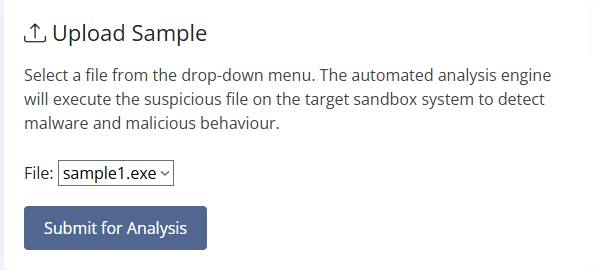
_Uploading sample1.exe to the Malware Sandbox_

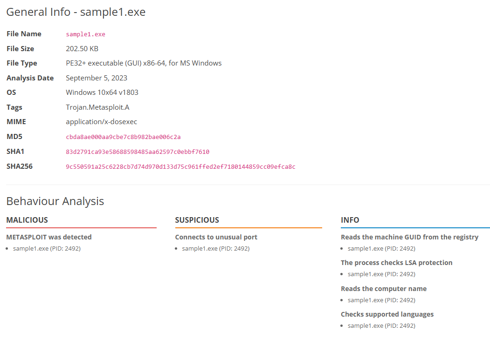
_The sandbox report for sample1.exe_

From the report, sample1.exe has the following characteristics:
- PE32+ executable for Windows
- Flagged as a Metasploit-based trojan (`Trojan.Metasploit.A`)
- MD5, SHA1, and SHA256 hashes
- Connects to an unusual port
- Reads the registry, checks LSA protection, reads the computer name, and checks supported languages

The menu on the left holds the rest of PicoSecure's tools.

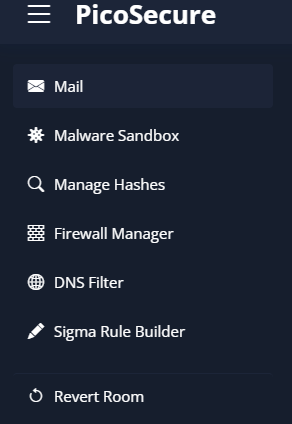
_The tools available in PicoSecure_

Starting at the bottom of the pyramid means blocking the file by its hash. This is the weakest block, because any change to the file changes its hash: swapping a lowercase letter for a capital, adding a space at the end of a line, or using a Unicode character that looks the same.

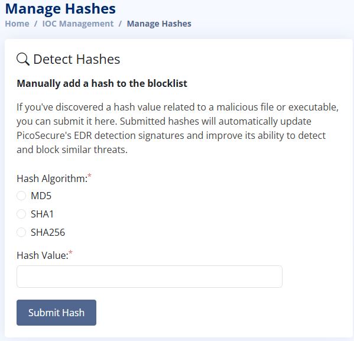
_The hash blocklist form_

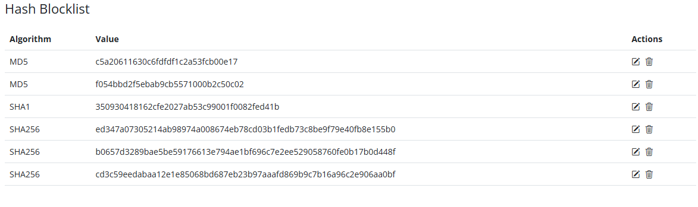
_The existing blocklist, with none of sample1's hashes_

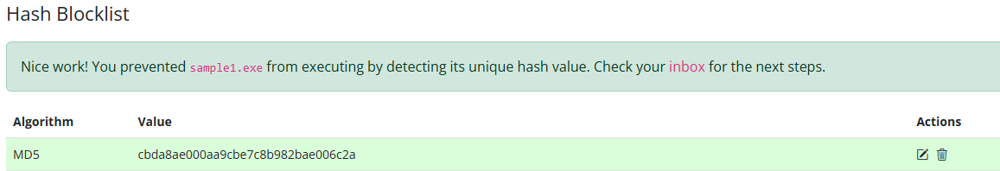
_Adding sample1's MD5 hash_

I only added one hash in this lab. In practice, I would add all three, and document why each was added (which sample or incident it came from). Adding all three makes no difference to the attacker, since changing the file changes all three hashes and gets past every block. But different tools and threat feeds use different hash types (one may only match SHA256, another may only have MD5), so adding all three makes sure every tool can match the file.

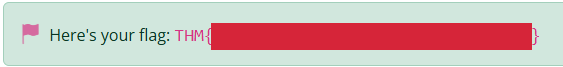
_Flag 1 (redacted)_

## Level 2: IP addresses

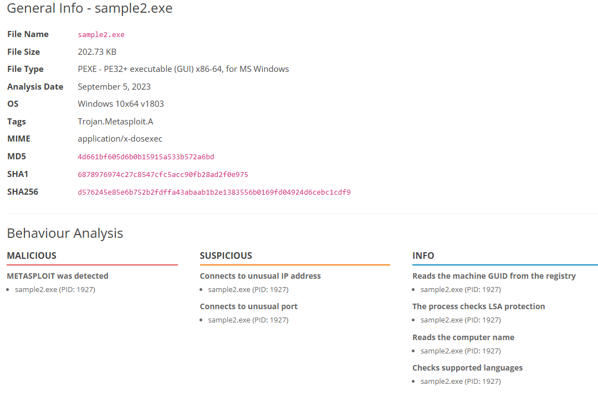
_The sandbox report for sample2.exe_

The analysis is mostly the same: a Metasploit trojan, an unusual port, and the same INFO behaviors. But it picked up a new feature in that it connects to an unusual IP address, and every hash is different. Changing the input even slightly gives a completely different output from a hashing algorithm.

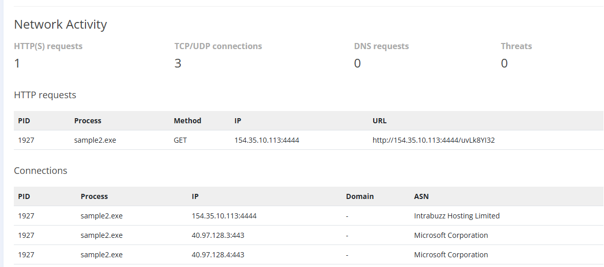
_sample2 makes an HTTP GET to 154.35.10.113 on port 4444_

It makes an HTTP GET to a bare IP address, which legitimate software rarely does. This looks like the start of [Event Horizon](https://matthildom.dev/posts/event-horizon), where the malicious PowerShell made a GET for the attacker's hosted file and ran it in memory with IEX. It's a way for a trojan to pull things like payloads down to the machine. Port 4444 is also the default port for Metasploit, which matches the Metasploit detection in the behavior analysis.

When it comes to making firewall rules, we can block inbound or outbound traffic (ingress vs egress). In this case, the trojan is initiating the outbound request to the attacker, so we have to explicitly block the outbound connection. If we have a stateful firewall and only blocked inbound traffic, the replies would still be allowed through, because the connection started from the internal computer. Blocking outbound stops the conversation before it can even start.

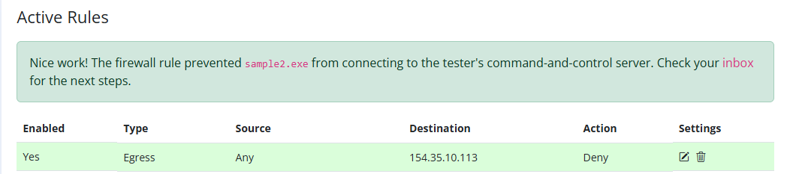
_Blocking all outbound traffic to 154.35.10.113_

This blocks all outbound traffic to the malicious IP, but it's easy for an attacker to change. The IP will change on its own if they don't have a static address, and they can move to a new host or a different cloud server.

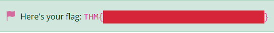
_Flag 2 (redacted)_

## Level 3: Domain names

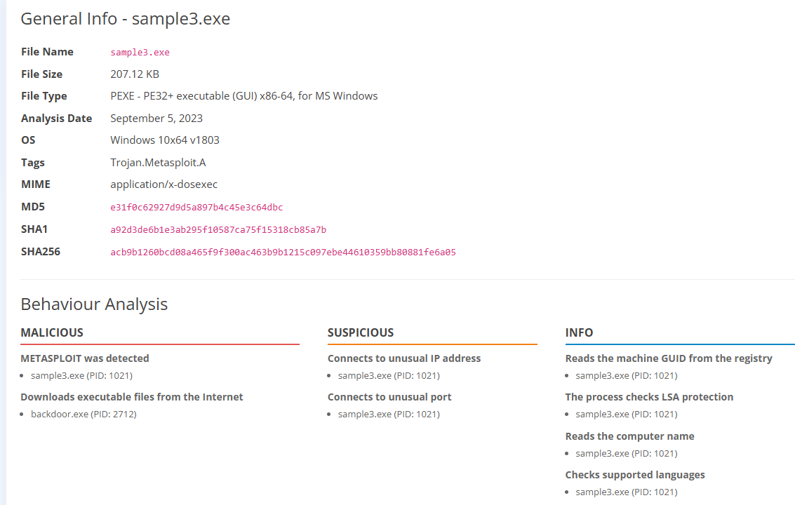
_The sandbox report for sample3.exe, now downloading backdoor.exe_

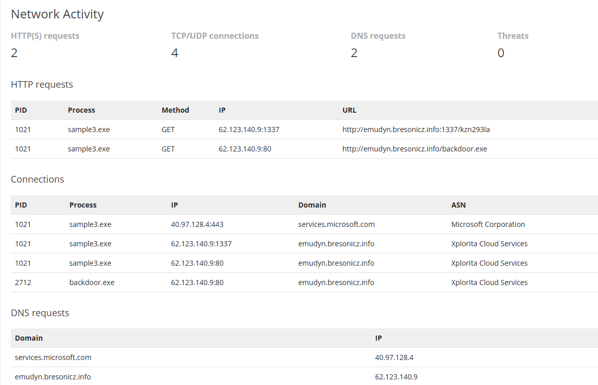
_New IP, new ports, and a domain: emudyn.bresonicz.info_

Like I predicted, they moved to a new IP (62.123.140.9) and new ports. The GET now goes out on port 1337, with a second GET for `backdoor.exe` on port 80. There's also a new malicious detection, downloading `backdoor.exe` from the internet, and two DNS requests.

PicoSecure has a DNS filter for known malicious domains.

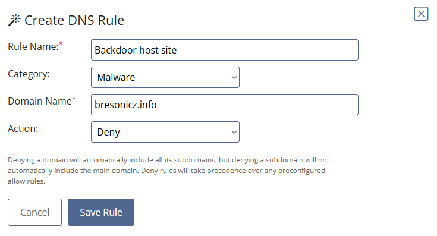
_Creating a DNS filter rule for bresonicz.info_

- The rule name doesn't change anything, but it should be easy to understand at a glance.
- The category is for sorting and logging and doesn't change the behavior either.
- For the domain, I dropped the subdomain so the rule blocks the whole domain, not just `emudyn`.

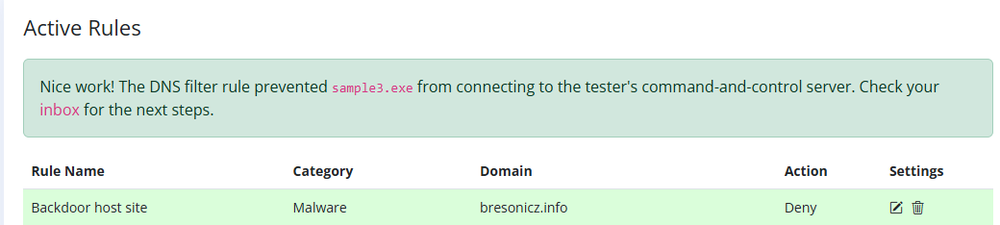
_The DNS rule saved_

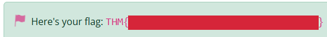
_Flag 3 (redacted)_

## Level 4: Host artifacts

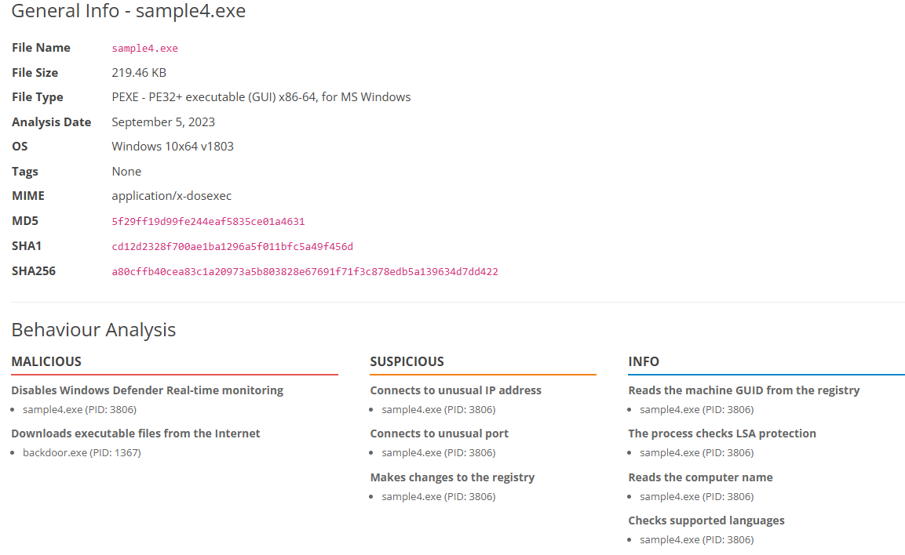
_sample4.exe picks up a new behavior: disabling Defender's real-time protection_

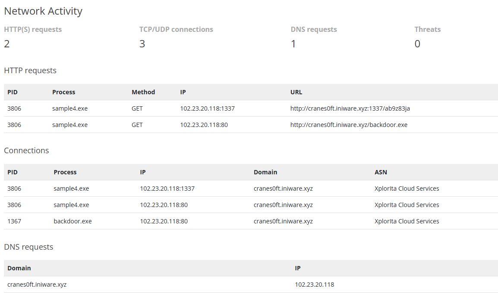
_Another new domain (cranes0ft.iniware.xyz) and IP_

New domain, new IP, new hashes, and a new SUSPICIOUS entry for registry changes. That's the host artifact.

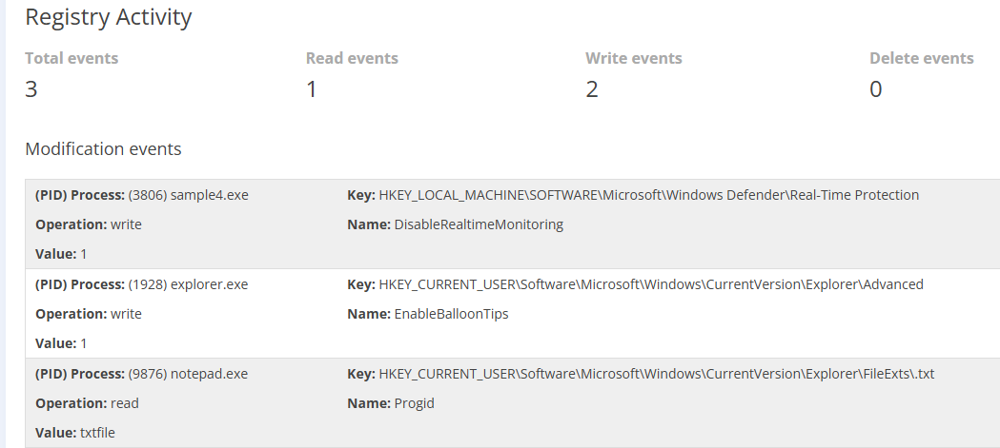
_Registry activity for sample4.exe_

- `notepad.exe` reads `FileExts\.txt` (Progid = `txtfile`). It's only reading, not writing.
- `explorer.exe` writes `EnableBalloonTips = 1` under Explorer\Advanced. Probably normal Windows noise.
- `sample4.exe` writes `DisableRealtimeMonitoring = 1`. This turns off Defender's real-time protection.

### Writing the Sigma rule

This one needs a Sigma rule.

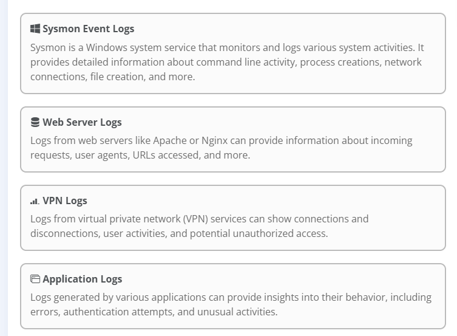
_Choosing a log source for the Sigma rule_

Before picking, the event IDs that cover registry changes:

- **Windows Security 4657:** a registry *value* was created, modified, or deleted
- **Windows Security 4670:** the permissions on an object (including a registry key) were changed
- **Sysmon 12:** a registry key was created or deleted
- **Sysmon 13:** a registry value was set
- **Sysmon 14:** a registry key or value was renamed

This is a value change, so Sysmon 13 or Windows 4657 is the one to watch. It turned out the room asks through a GUI, so I didn't need to know the specific event IDs.

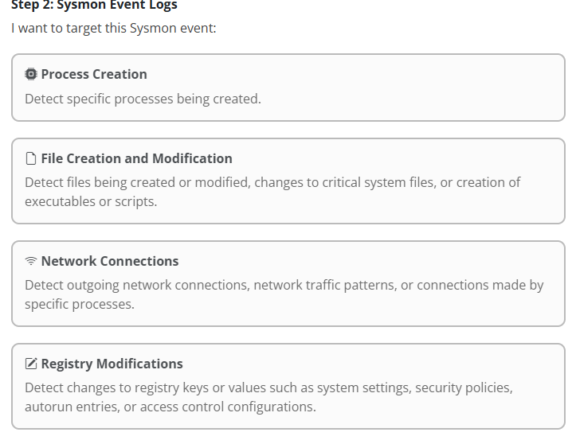
_The Sysmon event types the rule builder offers_

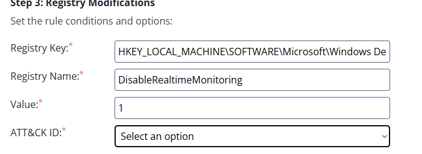
_The registry modification form: key, name, value, and ATT&CK ID_

I prioritized disabling Defender over the balloon tips change. Both should be alerted on, but an attacker turning off the antivirus is far more critical. Disabling Defender maps to T1685 "Disable or Modify Tools" under Defense Impairment (TA0112). The room's form only offers Defense Evasion (TA0005), because it predates ATT&CK v19, which split Defense Evasion and moved this technique. TA0005 itself is now named Stealth.

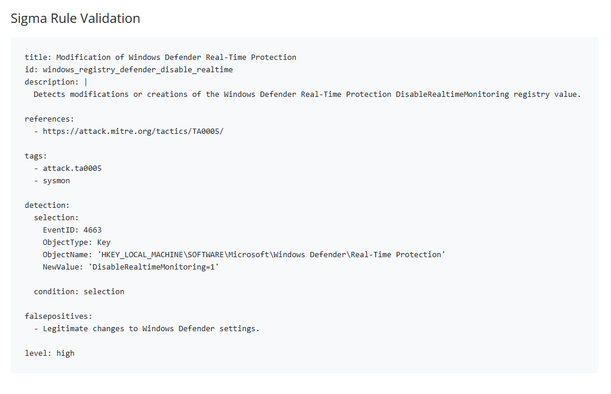
_The generated Sigma rule, tagged attack.ta0005_

Reviewing the generated rule, I noticed it alerts on Windows EventID 4663, which is "An attempt was made to access an object." That is a Security Log event, not a Sysmon event. This ultimately comes down to a simplified lab environment using a GUI-based selector. In the real world, I would have alerted on Sysmon 13 or Windows 4657 as mentioned above.

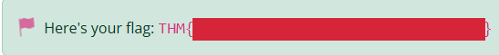
_Flag 4 (redacted)_

## Level 5: Tools

This email didn't include a sample like the others, so I didn't notice one existed and went straight to the network log attached to the email.

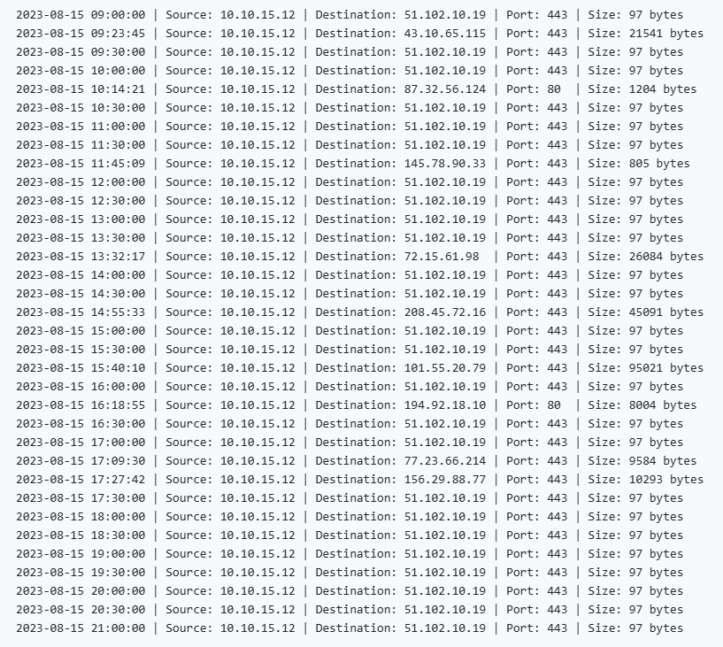
_outgoing_connections.log: 12 hours of outbound traffic from the victim_

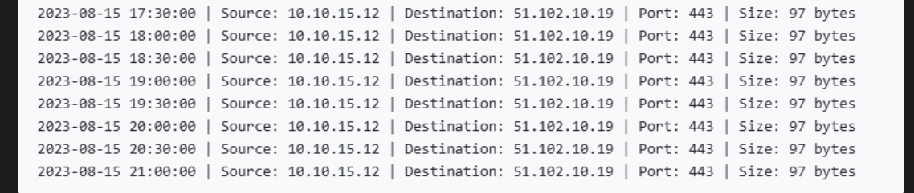
_Every 30 minutes: 97 bytes to 51.102.10.19 on port 443_

The log covers 12 hours on the victim's machine. Every 30 minutes the victim sends a small, 97-byte packet to the same IP on port 443. That looks like a check-in.

To filter out the check-ins, I copied the text into Notepad, swapped the pipes for commas, trimmed the "Source:"/"Destination:"/"Port:"/"Size:" labels, saved it as a CSV, and loaded it into Sheets.

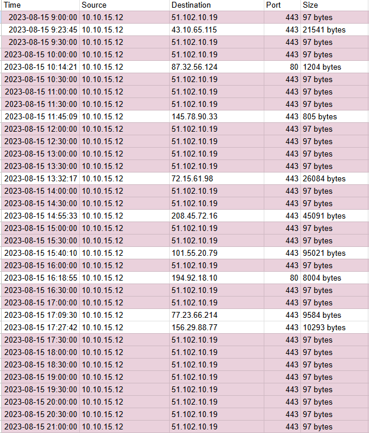
_The 30-minute, 97-byte check-ins highlighted in purple_

I highlighted the half-hour check-ins in purple, which helps to differentiate them from the other traffic. Mixed in are 9 other connections, each to a different IP, with 7 of the 9 hitting port 443 and the other 2 hitting port 80. I suspect some of this to be normal web traffic. In an earlier sample, we saw backdoor.exe downloaded over port 80, but the IPs have all changed since then.

While I was trying the tools, I opened the Malware Sandbox and found a sample5 after all. It just wasn't attached to the email like the others.

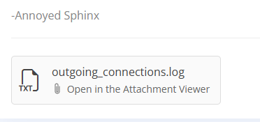
_The email only showed the log. A sample would normally be attached here._

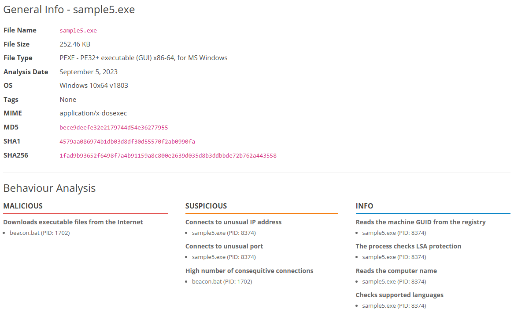
_sample5.exe: beacon.bat and a high number of consecutive connections_

The backdoor and trojan tags are gone, but there's a new behavior: `beacon.bat` making a high number of consecutive connections. That's the check-in from the log. The email that came with it mentions that they could send payloads to it directly, much like the mimikatz task in Event Horizon.

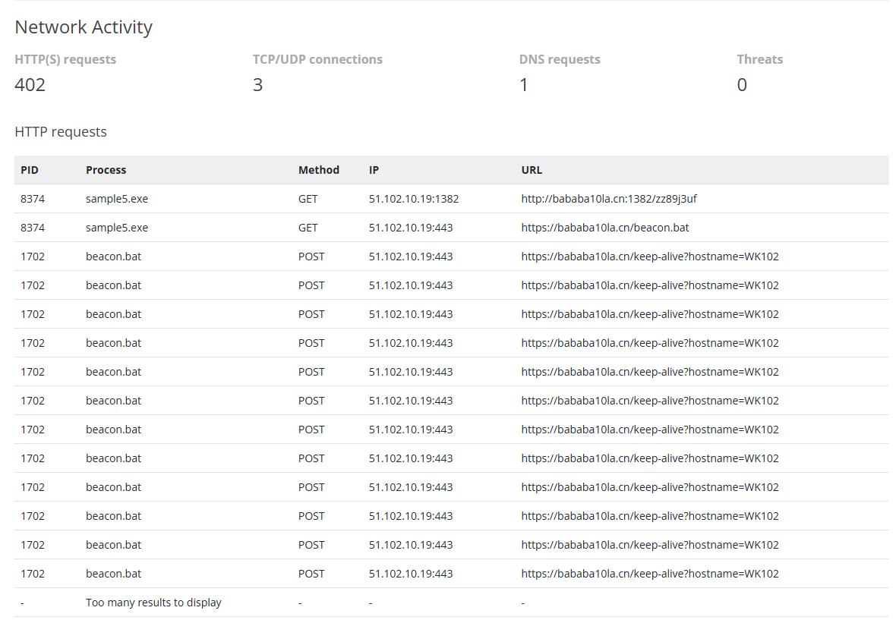
_Two GETs from sample5.exe, then a stream of POSTs from beacon.bat_

`sample5.exe` makes two GET requests to 51.102.10.19: one on port 1382, and one on 443 for `beacon.bat`. After that, `beacon.bat` sends a long run of POSTs to `/keep-alive?hostname=WK102` on port 443. That's the beacon, running continuously after it was downloaded.

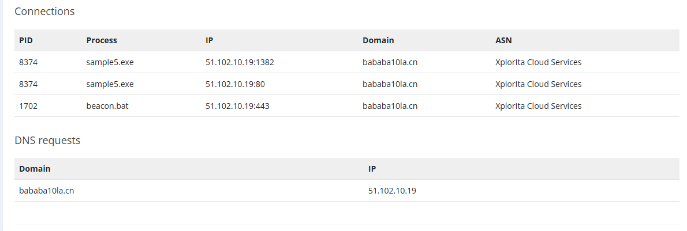
_bababa10la.cn resolves to 51.102.10.19, the same IP as the check-ins_

### Writing the Sigma rule

This time the rule is Sysmon network connections.

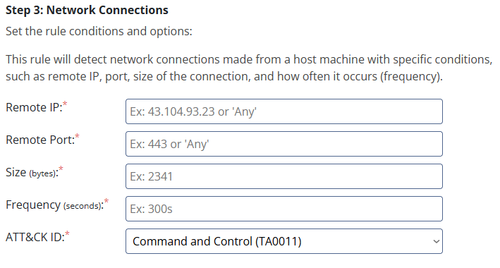
_The network connections form: remote IP, port, size, frequency, and ATT&CK ID_

The form requires a remote IP, port, size, and frequency. To catch the beacon, I used the pattern from the log as the condition. In reality this would need to be more complex, because the attacker could just change the interval. Detecting periodic traffic in general and alerting on that is more durable, which is probably why the Event Horizon implant had a jitter setting.

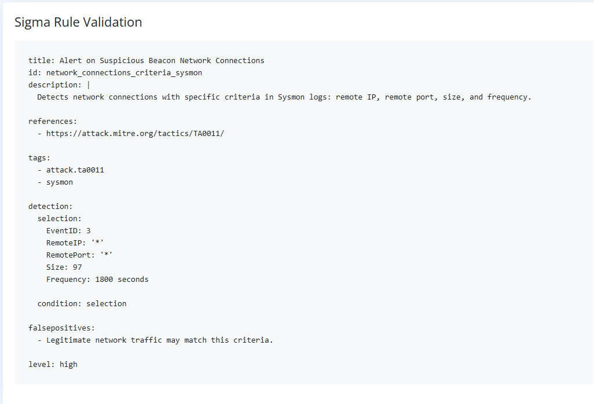
_Alerting on any IP and port with a size of 97 bytes every 1800 seconds_

This alerts on traffic to any IP and port with a size of 97 bytes and a frequency of 1800 seconds. Beaconing falls under Command and Control (TA0011). The rule matches on a network pattern, but getting around it requires the adversary to change how the beacon itself works, which is why the room counts this as the Tools level.

_Flag 5 (redacted)_

## Level 6: TTPs

This email came with `commands.log`, and this time I checked the Malware Sandbox for a sample right away.

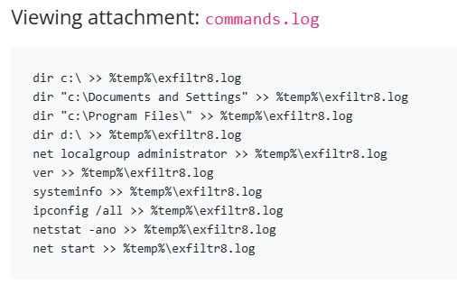
_commands.log: every output appended to %temp%\exfiltr8.log_

Each command appends its output to `%temp%\exfiltr8.log`: directory listings of `C:\`, Documents and Settings, Program Files, and `D:\`, then the local administrators group, the Windows version, `systeminfo`, `ipconfig /all`, `netstat -ano`, and the running services. The commands themselves are the Discovery tactic (TA0007), and gathering their output into one file is staging it (Data Staged, T1074).

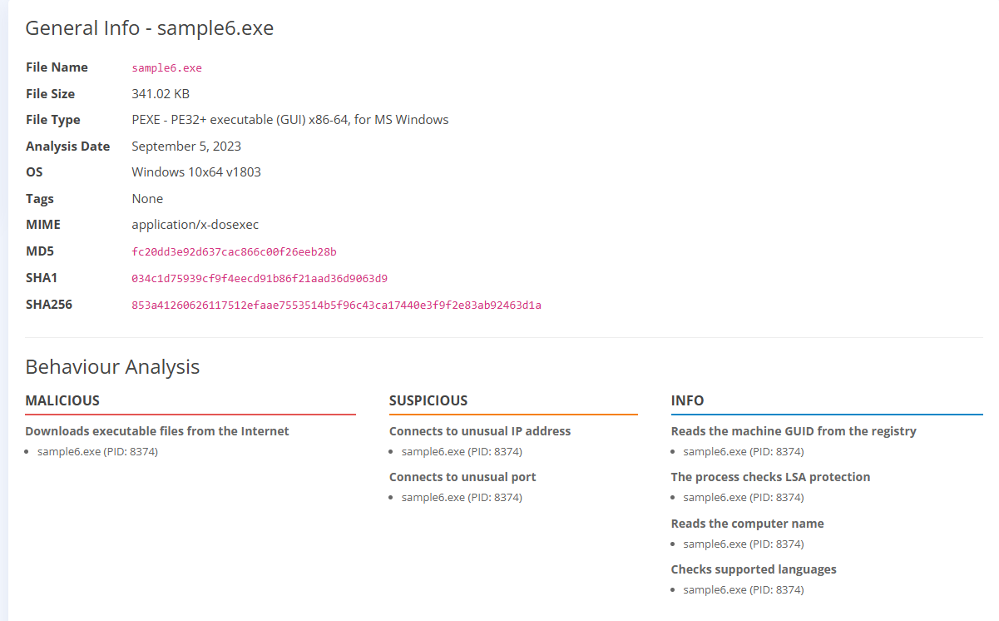
_The sandbox report for sample6.exe_

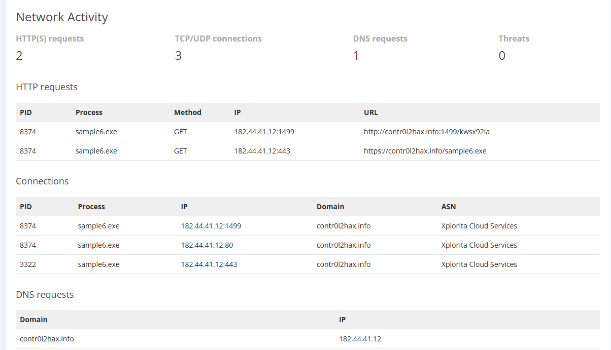
_A new domain again: contr0l2hax.info at 182.44.41.12_

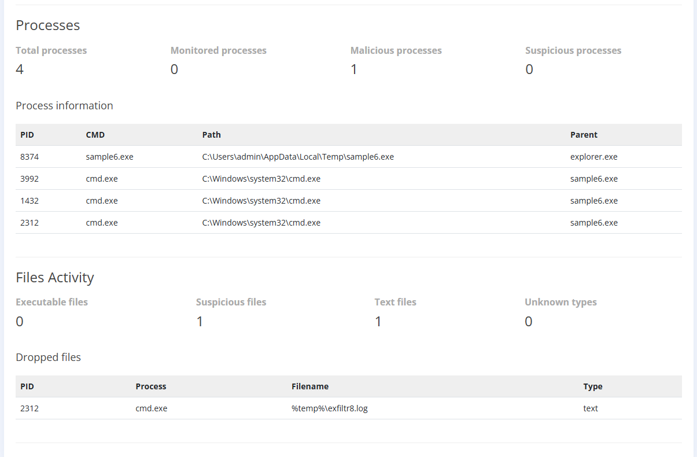
_sample6.exe runs from Temp and spawns three cmd.exe processes. One of them drops %temp%\exfiltr8.log._

The commands run through `cmd.exe`, and all three `cmd.exe` processes are children of `sample6.exe`. One of them (PID 2312) creates the log file.

### Writing the Sigma rule

This one is Sysmon file creation and modification. It requires a file path, file name, and ATT&CK ID. While the lab had me use Exfiltration (TA0010) here, I suspect that's a limitation of the simplified environment. At this point the file hasn't left the machine, so it would more likely be Collection (TA0009). In the real world, you would combine detections to look for the full chain of behavior: commands gathering information about the system (Discovery), collecting that information into a file (Collection), and then sending it somewhere (Exfiltration).

I set the alert to trigger on a file written to `%temp%` with the exact name `exfiltr8.log`, since that's what the command log showed. In reality, that's an incredibly brittle alert. Attackers generally wouldn't name a file something this obvious, and renaming a file is simple. The key thing this simplified example teaches is to monitor for behaviors and alert on them. Looking at how the steps connect, instead of one indicator at a time, lets us write detections that are much harder to get around.

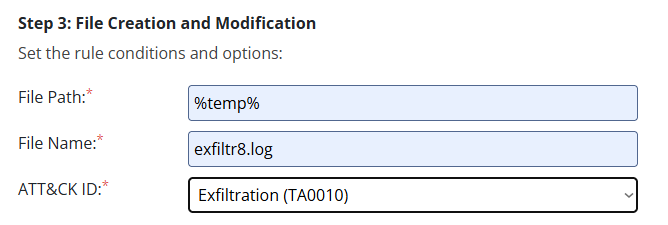
_The file creation form: %temp% and exfiltr8.log, tagged Exfiltration (TA0010)_

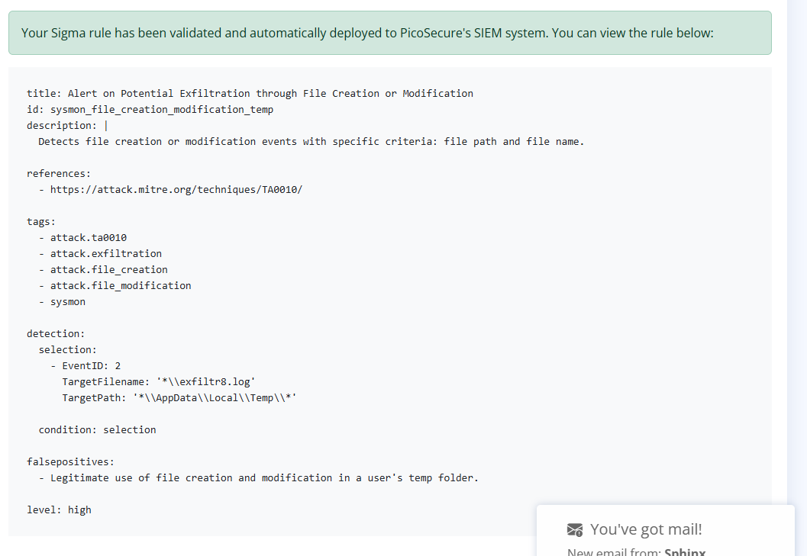
_The generated rule, matching exfiltr8.log in AppData\Local\Temp_

The generated rule shows another quirk like the one above. It uses Sysmon Event ID 2, "A process changed a file creation time." While that sounds right, Event 2 only fires when a process explicitly changes a file's creation timestamp, which is meant to catch timestomping (ATT&CK T1070.006). File creation is Sysmon Event ID 11 (FileCreate), which logs when a file is created or overwritten. The commands append to the log with `>>`, and the first one creates the file, so Event 11 is what would catch it.

_Flag 6 (redacted)_

## Takeaways

A quick lab to get me further into the SOC mindset, since that's where most of my recent job applications have been focused. It was a nice hands-on refresher on the Pyramid of Pain, and it introduced concepts I want to explore further: writing Sigma rules, choosing the right Sysmon event IDs, and mapping detections to ATT&CK.

Every block I put in place forced the attacker to change their approach, and each change cost them more. While it's nearly impossible to prevent attacks entirely, one of the most important things I've learned in security is that you need to make an attack more difficult than it's worth. If an attacker needs weeks or months to brute force an account, they might think twice if the payout is minimal. If a rule I write in 5 minutes costs an attacker hours or days to get around, that's a success. Time and money are limited resources on both sides, so using them efficiently is key.

Another thing I considered during this lab is that the Pyramid of Pain was created before AI, and with AI becoming more common in cybersecurity on both sides, priorities may shift. A model that can quickly modify its tooling can do more than get past hash-based blocks. It can rewrite the entire tool on the fly with a new path, new port, new timing and jitter, and modified commands, faster than any human. That makes the lower levels of the pyramid even less painful for an AI-driven adversary, and pushes defense toward the very top, putting a lot of weight on behavior-based detection. On the other side, defensive models can handle detection and alerting across the whole pyramid, automating the lower levels and freeing up more time for behavioral detection.

With my Event Horizon writeup from this week fresh in my mind, I noticed a lot of similarities in the attack shape: a download cradle, a beacon, and remote task delivery. This time I was seeing it from the detection side instead of reconstructing it afterward. It has me thinking about how I would prioritize alerts for that attack using the Pyramid of Pain, and how I would remediate it.

